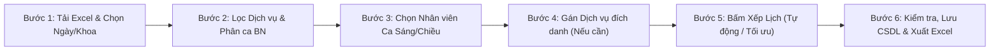

# HƯỚNG DẪN SỬ DỤNG: PHÂN HỆ CHIA THỜI GIAN THỰC HIỆN DVKT & PTTT
> **Đường dẫn màn hình:** `/clinical-scheduling/schedule`  
> **Áp dụng cho:** Các Khoa Lâm sàng, Cận lâm sàng, Khoa Y học Cổ truyền - Phục hồi Chức năng & Toàn viện  
> **Cập nhật gần nhất:** Tháng 11/2026 (Phiên bản đồng bộ Bảng Chấm Công & Cơ chế Ưu tiên CCHN)

---

## I. MỤC ĐÍCH & Ý NGHĨA NGHIỆP VỤ

Phân hệ **Chia thời gian thực hiện Dịch vụ Kỹ thuật (DVKT) & Phẫu thuật - Thủ thuật (PTTT)** được thiết kế nhằm tự động hóa quy trình phân bổ khung giờ thực hiện kỹ thuật cho người bệnh tại các khoa lâm sàng:
1. **Tuân thủ định mức BHYT:** Đảm bảo thời gian thực hiện, khoảng cách nghỉ (buffer time), số ca tối đa của bác sĩ/điều dưỡng và máy móc không vượt quá định mức Bộ Y tế và Giám định BHYT.
2. **Loại trừ chồng chéo 3 chiều:** Không bao giờ để xảy ra tình trạng:
   - Một **Bệnh nhân** cùng lúc làm 2 dịch vụ khác nhau.
   - Một **Bác sĩ/Điều dưỡng** cùng lúc làm 2 thủ thuật khác nhau (trừ các kỹ thuật được cấu hình cho phép giám sát song song).
   - Một **Máy móc/Thiết bị** cùng lúc phục vụ 2 người bệnh.
3. **Kiểm soát chặt chẽ Chứng chỉ hành nghề (CCHN):** Chỉ những nhân sự có CCHN và Phạm vi hành nghề (Scope) phù hợp mới được hệ thống xếp lịch. Nhân sự không có CCHN (như Hộ lý) tuyệt đối không được phân công DVKT.
4. **Cơ chế phân bổ thông minh:** Hỗ trợ ưu tiên nhân sự đích danh, phân ca Sáng / Chiều linh hoạt và chuyển tiếp ca an toàn khi nhân sự chính kín lịch.

---

## II. QUY TRÌNH 6 BƯỚC THAO TÁC CHUẨN

---

### BƯỚC 1: TẢI FILE EXCEL Y LỆNH & CHỌN NGÀY / KHOA

1. Tại khung **"1. Chọn thông tin xếp lịch"**:
   - **Khoa / Phòng:** Chọn đúng khoa cần chia lịch (Ví dụ: `Khoa Y học cổ truyền`).
   - **Ngày thực hiện:** Chọn ngày làm việc cần chia thời gian (Định dạng: `DD/MM/YYYY`).
2. Bấm nút **"Tải lên Excel"** và chọn file Excel trích xuất từ phần mềm HIS/Bệnh án điện tử.
   - Hệ thống tự động nhận diện các cột: Mã bệnh án (`ma_ba`), Tên bệnh nhân (`ten_bn`), Mã dịch vụ (`ma_dich_vu`), Tên dịch vụ (`ten_dich_vu`), Thời gian y lệnh (`thoi_gian_chi_dinh`).
   - Sau khi tải lên thành công, hệ thống hiển thị số lượng ca chờ xếp lịch trong ngày.

---

### BƯỚC 2: BỘ LỌC DỊCH VỤ VÀ PHÂN CA BUỔI THEO DỊCH VỤ / BỆNH NHÂN

1. **Bộ lọc Dịch vụ:** Mặc định hệ thống tích chọn toàn bộ các dịch vụ kỹ thuật có trong file Excel. Người dùng có thể bỏ tick những dịch vụ không muốn chia thời gian hôm nay.
2. **Tùy chọn Bệnh nhân ưu tiên theo buổi (Tab Tùy chọn nâng cao):**
   - **Ưu tiên buổi Sáng (07:35 - 11:30):** Chọn các bệnh nhân cần hoàn thành sớm để ra viện, chuyển viện hoặc chuyển khoa.
   - **Ưu tiên buổi Chiều (13:35 - 17:00):** Chọn các bệnh nhân chỉ làm vào buổi chiều.
   - **Khung giờ hẹn xong trước:** Thêm giờ kết thúc cụ thể cho bệnh nhân cần ra viện sớm (ví dụ: *Ra viện lúc 10:00*). Hệ thống sẽ ưu tiên cao nhất để xếp các ca của người bệnh này xong trước giờ hẹn.
3. **Tùy chọn Dịch vụ kỹ thuật ưu tiên theo buổi:**
   - Chọn những dịch vụ chỉ làm buổi sáng hoặc chỉ làm buổi chiều (hệ thống tự động lưu cấu hình này theo từng khoa phòng).

---

### BƯỚC 3: PHÂN BỔ NHÂN SỰ THEO BUỔI & CƠ CHẾ CA (MỚI)

Tại khối **"Tùy chọn Người thực hiện theo buổi"**, người quản lý khoa có thể phân công nhân sự làm việc:

| Trường cấu hình | Hướng dẫn thao tác & Ý nghĩa |
| :--- | :--- |
| **Người thực hiện buổi Sáng** | Chọn các Bác sĩ / Điều dưỡng chuyên trách làm ca Sáng (`07:35 - 11:30`). |
| **Người thực hiện buổi Chiều** | Chọn các Bác sĩ / Điều dưỡng chuyên trách làm ca Chiều (`13:35 - 17:00`). |
| *(Để trống cả 2 ô)* | Hệ thống **tự động phân bổ tất cả nhân sự có CCHN làm việc cả ngày** (Sáng lấp đầy trước, sau đó xếp tiếp buổi Chiều). |

#### 👉 Cơ chế phân bổ buổi (Chọn 1 trong 2 chế độ):
1. 🔘 **Cố định ca:** Chỉ xếp lịch cho người đó trong đúng buổi đã chọn.
   - *Ví dụ:* Chọn Điều dưỡng Trần Thị Huyền làm ca Sáng thì Huyền **chỉ nhận ca từ 07:35 đến 11:30**, buổi chiều tuyệt đối không chia ca cho Huyền.
2. 🔘 **Ưu tiên ca (Khuyên dùng khi việc nhiều):** Ưu tiên lấp đầy buổi đã chọn trước; nếu buổi sáng đã hết bệnh nhân hoặc buổi chiều còn nhiều việc, hệ thống **cho phép người đó làm tiếp cả buổi còn lại** để tận dụng tối đa năng suất.

---

### BƯỚC 4: GÁN DỊCH VỤ ĐÍCH DANH (CƠ CHẾ ƯU TIÊN & CHUYỂN TIẾP MỚI)

Khi cần chỉ định một hoặc nhóm kỹ thuật viên thực hiện các dịch vụ đặc thù:
1. Tích chọn: **"Bật tuỳ chọn: Gán Dịch vụ cho đích danh người thực hiện"**.
2. Tại từng dòng dịch vụ, chọn nhân sự tương ứng (có thể chọn 1 hoặc nhiều người).

#### 💡 Nguyên tắc vận hành "Soft Priority + Fallback" thông minh:
- **Ưu tiên người được gán (Priority):** Hệ thống sẽ ưu tiên tối đa xếp các ca của dịch vụ này cho nhân sự được chọn cho đến khi người đó hết giờ rảnh / kín lịch (có bao nhiêu thời gian chia bấy nhiêu ca).
- **Tự động chuyển tiếp (Fallback an toàn):** Khi người được gán đã kín lịch, thuật toán **KHÔNG BÁO LỖI**, mà **tự động chuyển tiếp các ca còn lại cho các nhân sự khác trong khoa có CCHN phù hợp** với kỹ thuật đó để hoàn thành ca bệnh.
- *Lưu ý:* Nếu không chọn ai, hệ thống sẽ tự động chia đều cho toàn bộ nhân sự có CCHN phù hợp trong khoa.

---

### BƯỚC 5: KIỂM SOÁT ĐIỀU KIỆN CHẤM CÔNG & CCHN (NGHIÊM NGẶT)

Hệ thống áp dụng 2 tầng kiểm soát bảo vệ:

#### 1. Kiểm soát Chứng chỉ hành nghề (CCHN):
- **Bắt buộc có CCHN:** Chỉ nhân sự có CCHN còn hoạt động và có Phạm vi hành nghề (Scope) trùng khớp với dịch vụ mới được hệ thống chia ca.
- **Loại trừ Hộ lý 100%:** Những nhân sự có chức danh / trình độ là **Hộ lý** (ví dụ: *Tô Thị Mai - BV0576*) hoặc nhân sự không có CCHN y tế **tuyệt đối không bao giờ được hệ thống chia ca DVKT** (luôn nhận đúng 0 ca).

#### 2. Cấu hình Hệ thống: Bắt buộc chấm công mới được chia lịch
*(Quản lý tại trang `Quản trị hệ thống` -> `/system-config` -> Module `CHIA_LICH_PTTT`)*:
- **Khi BẬT (`true`):** Khoa bắt buộc phải điểm danh/chấm công ngày đó trước khi chia lịch. Nếu chưa điểm danh, hệ thống sẽ báo cảnh báo:
  > *"Quy định Bệnh viện yêu cầu Khoa phải hoàn thành chấm công/điểm danh ngày [DD/MM/YYYY] trước khi chia lịch PTTT. Vui lòng điểm danh tại tab 'Điểm danh' trước!"*
- **Khi TẮT (`false` - Mặc định linh hoạt):** Nếu ngày đó chưa có dữ liệu chấm công, hệ thống mặc định toàn bộ Bác sĩ, Điều dưỡng có CCHN trong khoa đều đi làm bình thường để phục vụ chia lịch trước/chia nhanh. Nếu ngày đó đã có chấm công, hệ thống tự động loại bỏ người chấm nghỉ phép (`P`), nghỉ ốm (`Ô`), thai sản (`TS`)...

---

### BƯỚC 6: CHẠY XẾP LỊCH, KIỂM TRA & XUẤT BÁO CÁO

1. Bấm một trong hai nút:
   - **Xếp lịch (Theo thứ tự/Nhanh):** Phù hợp với các khoa khối lượng vừa phải.
   - **Xếp lịch tối ưu (Khuyên dùng):** Sử dụng thuật toán heuristic (LPT) kết hợp cân bằng tải ngẫu nhiên máy móc và nhân sự, giúp tối đa hóa số ca thành công và giãn cách đều các bàn/máy.
2. Kiểm tra kết quả tại khối **"Kết quả Xếp lịch"**:
   - Tab **Người thực hiện:** Xem chi tiết danh sách ca của từng Bác sĩ / Điều dưỡng theo buổi Sáng và Chiều.
   - Tab **Tên Bệnh nhân:** Kiểm tra chuỗi thời gian làm dịch vụ của từng bệnh nhân xem có bị chồng chéo hay không.
   - Tab **Bảng thời gian rảnh:** Thống kê các khoảng thời gian trống của nhân sự trong ngày.
   - Tab **Thống kê theo Người thực hiện:** Bảng tổng hợp số lượng ca và tổng thời lượng làm việc của từng nhân viên.
   - Tab **Dịch vụ không thể xếp lịch (Màu đỏ nếu có):** Xem các ca không thể bố trí được kèm theo lý do cụ thể (Ví dụ: *Thiếu máy móc, đã kín lịch toàn bộ khoa...*).
3. **Lưu & Xuất báo cáo:**
   - Bấm **"Lưu vào CSDL"**: Lưu trữ lịch xếp để bảo lưu và phục vụ kiểm tra, đối chiếu.
   - Bấm **"Tải Excel (Mẫu 1)"** hoặc **"Tải Excel (Mẫu 2)"**: Xuất file Excel hoàn chỉnh có định dạng chuẩn Bộ Y tế, có phân trang riêng cho từng Bác sĩ / Điều dưỡng để in ký giao ban hàng ngày.

---

## III. BẢNG MÃ LỖI THƯỜNG GẶP & CÁCH XỬ LÝ NHANH

| Mã lỗi hiển thị | Nguyên nhân gốc rễ | Hướng dẫn khắc phục |
| :--- | :--- | :--- |
| **"Quy định Bệnh viện yêu cầu Khoa phải hoàn thành chấm công..."** | Hệ thống đang bật cấu hình bắt buộc chấm công nhưng ngày chọn chưa có dữ liệu điểm danh. | Chuyển sang tab **"Điểm danh"** trên cùng màn hình, kiểm tra và xác nhận điểm danh cho khoa trong ngày đó rồi quay lại bấm Xếp lịch. |
| **"Dịch vụ chưa cấu hình Phạm vi hành nghề yêu cầu"** | Dịch vụ kỹ thuật này trong danh mục Mẫu 05 chưa được gán mã Scope tương ứng. | - **Cách 1:** Tại tab *Cấu hình DVKT (Mẫu 05)*, chọn dịch vụ và cập nhật Scope phù hợp. - **Cách 2:** Tích chọn *Gán Dịch vụ cho đích danh* và chỉ định Bác sĩ/Điều dưỡng phụ trách. |
| **"Không có thiết bị loại [Tên máy] khả dụng trong ngày"** | Dịch vụ yêu cầu máy (ví dụ `MAY_DIEN_CHAM`), nhưng Khoa chưa khai báo máy này trong danh mục trang thiết bị hoạt động của khoa. | Vào phân hệ *Quản lý Thiết bị / Mẫu 06* bổ sung máy cho khoa hoặc tạm thời bỏ yêu cầu máy của dịch vụ đó tại tab Cấu hình DVKT. |
| **"Đã kín lịch hoặc không có máy trống trong toàn bộ khung giờ"** | Tổng số phút thực hiện của các ca bệnh vượt quá tổng quỹ thời gian làm việc trong ngày của khoa hoặc của người được chỉ định. | - Nếu đang gán đích danh ca sáng: Đổi sang cơ chế **Ưu tiên ca** để hệ thống chia tiếp sang buổi chiều. - Bổ sung thêm nhân sự hỗ trợ hoặc kéo dài khung giờ làm việc của khoa tại trang Cấu hình. |

---

## IV. TÀI LIỆU KỸ THUẬT & API LIÊN QUAN

Dành cho Quản trị viên và Lập trình viên hệ thống:
- **API Chia lịch tuần tự:** `POST /api/clinical-scheduling/generate`
- **API Chia lịch tối ưu hóa:** `POST /api/clinical-scheduling/generate-optimized`
- **API Quản lý Điểm danh khoa:** `GET/POST /api/clinical-scheduling/attendance`
- **API Cấu hình giờ làm & Buffer:** `GET/POST /api/clinical-scheduling/config`
- **Mã cấu hình toàn viện (SystemConfig):** `CLINICAL_SCHEDULING_REQUIRE_ATTENDANCE` (`BOOLEAN`)

