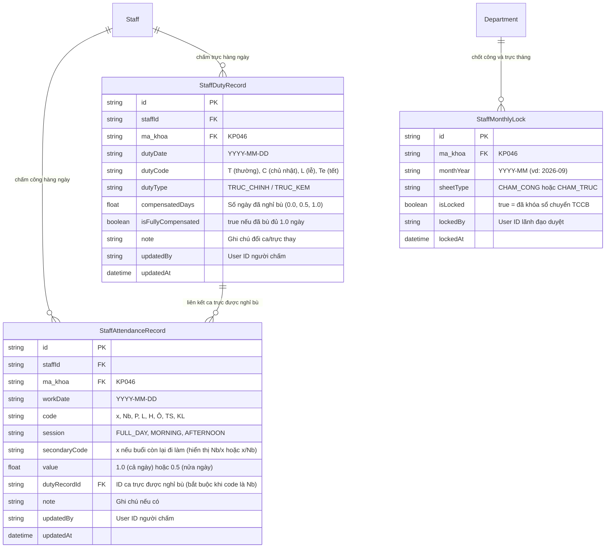

# 📋 BẢN KẾ HOẠCH & PHÂN TÍCH TRIỂN KHAI PHÂN HỆ
## CHẤM CÔNG & CHẤM TRỰC PHÒNG CÔNG NGHỆ THÔNG TIN
### Đối soát trực tiếp từ 2 file mẫu: `mau/staff/Bảng chấm công từ T6.2025.xlsx` & `mau/staff/Bảng chấm trực.xlsx`

---

## 1. PHÂN TÍCH CHI TIẾT 2 FILE EXCEL MẪU TRONG `mau/staff`

Qua rà soát kỹ thuật cấu trúc dữ liệu của 2 file Excel thực tế tại Bệnh viện:

### 1.1. File 1: `Bảng chấm công từ T6.2025.xlsx`
- **Tiêu đề & Quốc hiệu**:
  - Dòng 1: `BỆNH VIỆN ĐA KHOA TỈNH LẠNG SƠN`
  - Dòng 2: `PHÒNG CÔNG NGHỆ THÔNG TIN`
  - Dòng 3: `BẢNG CHẤM CÔNG` (In hoa, cỡ chữ lớn, căn giữa)
  - Dòng 4: `Tháng  {M} năm {YYYY}`
- **Bố cục các cột**:
  - Cột A: `Số TT` (1, 2, 3...)
  - Cột B: `Họ và Tên` (Lâm An Biên, Nguyễn Thiện An, Nguyễn Việt Hà, Đặng Huy Đức, Nông Hoàng Phương, Hoàng Thế Lâm, Trương Thị Quỳnh Trang...)
  - Cột C -> AG: `Ngày trong tháng` (Từ ngày 1 đến ngày 31)
  - Cột AH -> AJ (Nhóm *Quy ra công*):
    - **Cột AH**: `Số công hưởng lương thời gian` (Tổng số ngày làm việc thực tế + nghỉ bù + nghỉ phép + lễ tết...)
    - **Cột AI**: `Số công nghỉ không lương`
    - **Cột AJ**: `Số công hưởng BHXH` (Nghỉ ốm, thai sản...)
- **Bảng ký hiệu chấm công chuẩn**:
  - `x`: Đi làm hưởng lương thời gian (8 giờ)
  - `Nb`: Nghỉ bù (sau ngày trực đêm/trực phiên) -> Vẫn được tính công hưởng lương!
  - `P`: Nghỉ phép năm
  - `L`: Nghỉ ngày lễ (hưởng nguyên lương)
  - `H`: Đi học, tập huấn, đào tạo bồi dưỡng
  - `Ô`: Nghỉ ốm đau hưởng chế độ BHXH
  - `TS`: Nghỉ thai sản hưởng chế độ BHXH
  - `KL`: Nghỉ không hưởng lương
- **Dòng tổng kết & Chữ ký**:
  - Dòng `CỘNG`: Tổng số công toàn phòng trong tháng.
  - Ngày lập bảng: `Ngày 01 tháng {M+1} năm {YYYY}`
  - 4 khối chữ ký thẩm quyền:
    1. **Người chấm công** (*Trương Thị Quỳnh Trang*)
    2. **Phụ trách bộ phận** (*Lâm An Biên*)
    3. **Phòng Tổ chức cán bộ**
    4. **Thủ trưởng đơn vị**

---

### 1.2. File 2: `Bảng chấm trực.xlsx` (Mẫu C01b - YT theo QĐ 144-BHYT/QĐ)
- **Tiêu đề & Biểu mẫu**:
  - Dòng 1: `BẢNG CHẤM CÔNG THƯỜNG TRỰC CHUYÊN MÔN Y TẾ ĐƯỢC PHỤ CẤP`
  - Góc trên bên phải: `Mẫu số C01b - YT (Ban hành theo QĐ 144-BHYT/QĐ Ngày 31/07/1997)`
  - Dòng 2: `Tháng  {M} năm {YYYY}`
  - Dòng 3 - 4: `BỆNH VIỆN ĐA KHOA TỈNH LẠNG SƠN` - `PHÒNG CÔNG NGHỆ THÔNG TIN`
  - `PHẦN I - CHẤM CÔNG`
- **Bố cục các cột**:
  - Cột A: `Số TT`
  - Cột B: `HỌ VÀ TÊN`
  - Cột C: `Cộng bậc lương`
  - Cột D -> AH: `NGÀY TRONG THÁNG` (Từ ngày 1 đến ngày 31)
  - Cột AI -> AL (Nhóm *Cộng số ngày trực trong tháng*):
    - **Cột AI**: `Ngày thường` (Đếm số phiên trực ngày thường `T`)
    - **Cột AJ**: `T7,CN` (Đếm số phiên trực thứ Bảy, Chủ nhật `C`)
    - **Cột AK**: `Lễ tết` (Đếm số phiên trực ngày lễ `L`, ngày tết `Te`)
    - **Cột AL**: `Tổng Số` (Tổng cộng các phiên trực trong tháng)
- **Bảng ký hiệu chấm trực chuẩn**:
  - `T`: Phiên trực ngày thường
  - `C`: Phiên trực ngày chủ nhật (hoặc thứ 7, chủ nhật)
  - `L`: Phiên trực ngày lễ
  - `Te`: Phiên trực ngày tết
- **Mối liên hệ thực tế giữa Chấm Trực & Chấm Công**:
  - Khi nhân viên có phiên trực đêm (`T`, `C`, `L`, `Te`), ngày hôm sau (hoặc ngày liền kề theo phân công) sẽ được chấm **`Nb` (Nghỉ bù)** trên Bảng Chấm Công hành chính.
- **Dòng tổng kết & Chữ ký**:
  - Dòng `CỘNG`: Tổng số phiên trực thường, trực T7/CN, trực lễ tết.
  - Bảng ghi chú các ký hiệu chấm công: `T`, `C`, `L`, `Te`.
  - 3 khối chữ ký thẩm quyền:
    1. **Người chấm công** (*Trương Thị Quỳnh Trang*)
    2. **Phụ trách bộ phận** (*Lâm An Biên*)
    3. **Thủ trưởng đơn vị**

---

## 2. HIỆN TRẠNG DỮ LIỆU NHÂN SỰ PHÒNG CNTT TRONG CƠ SỞ DỮ LIỆU

Hệ thống đã có sẵn 8 nhân sự thuộc **Phòng Công nghệ thông tin (Mã khoa: `KP046`)**:

| STT | Mã NV | Họ và tên | Chức danh / Vai trò | Username tài khoản | Liên kết User (staffId) |
| :---: | :---: | :--- | :--- | :---: | :---: |
| 1 | `BV0659` | **Lâm An Biên** | Trưởng phòng | *admin* | ✅ Đã liên kết |
| 2 | `BV0663` | **Nguyễn Thiện An** | Cán bộ CNTT | `1` | ✅ Đã liên kết |
| 3 | `BV0665` | **Nguyễn Việt Hà** | Cán bộ CNTT | `020085002388` | ✅ Đã liên kết |
| 4 | `BV0853` | **Đặng Huy Đức** | Cán bộ CNTT | `020082008345` | ✅ Đã liên kết |
| 5 | `BV0662` | **Nông Hoàng Phương** | Cán bộ CNTT | `020085000582` | ✅ Đã liên kết |
| 6 | `BV1066` | **Hoàng Thế Lâm** | Cán bộ CNTT | `025087001673` | ✅ Đã liên kết |
| 7 | `BV1067` | **Trương Thị Quỳnh Trang** | Thư ký / Cán bộ chấm công | `BV1067` | Sẵn sàng liên kết |
| 8 | `BV0660` | **Hoàng Đình Dũng** | Cán bộ CNTT | `020082002600` | ✅ Đã liên kết |

👉 **Thuận lợi rất lớn**: Dữ liệu cán bộ và tài khoản đăng nhập đã có đầy đủ, sẵn sàng đồng bộ 100% đến từng tài khoản nhân viên!

---

## 3. THIẾT KẾ CƠ SỞ DỮ LIỆU PRISMA (ADDITIVE-ONLY)

Để đáp ứng vừa chấm hàng ngày, vừa chốt cuối tháng và đồng bộ cá nhân:

---

## 4. QUY TRÌNH NGHIỆP VỤ & THIẾT KẾ GIAO DIỆN (UI/UX)

Hệ thống được chia thành 2 phân hệ rõ ràng:

### 4.1. Dành cho Lãnh đạo / Người chấm công (Trưởng phòng / Thư ký phòng)
- **Màn hình**: Quản lý Chấm công & Chấm trực Khoa phòng (`/staff/attendance-manager`)
- **Giao diện Bảng Lưới Matrix (từ ngày 1 đến 31)**:
  - Bộ lọc chọn: **Tháng/Năm** (mặc định tháng hiện tại), Chọn xem **Bảng Chấm Công** hoặc **Bảng Chấm Trực**.
  - Bảng lưới hiển thị toàn bộ nhân sự phòng CNTT theo hàng dọc, các ngày trong tháng theo hàng ngang (tô màu nhận diện Thứ Bảy, Chủ Nhật).
  - **Thao tác chấm thủ công cực nhanh**:
    - Nhấp chuột trực tiếp vào ô để chọn nhanh ký hiệu (`x`, `Nb`, `P`, `T`, `C`, `L`...).
    - Hỗ trợ phím tắt và nút "Điền nhanh cả cột cho ngày hôm nay (Đi làm đủ `x`)".
    
  - **Quy trình Chấm Nghỉ Bù (`Nb`) thông minh (Bắt buộc gắn với ca trực)**:
    - **Nguyên tắc chặt chẽ**: Chỉ nhân viên CÓ ca trực (chưa nghỉ bù hoặc còn dư ngày bù) mới được chấm `Nb`. Nếu nhân viên không có ca trực hợp lệ, hệ thống cảnh báo và không cho chấm `Nb`.
    - **Modal / Popover chọn ca trực khi chấm `Nb`**:
      1. *Danh sách ca trực*: Dropdown hiển thị các ca trực chưa được bù đủ của nhân viên (Ví dụ: `Trực Đêm 05/10/2026 (Ca T) - Còn lại: 1.0 ngày`).
      2. *Lựa chọn thời lượng nghỉ bù*:
         - 🔘 **Cả ngày**: Nghỉ bù trọn vẹn 1 ngày công $\rightarrow$ Hiển thị ký hiệu `Nb` (trừ 1.0 ngày bù của ca trực).
         - 🔘 **Nửa ngày Sáng (Chiều đi làm `x`)**: Sáng nghỉ bù, Chiều làm việc bình thường $\rightarrow$ Hiển thị ký hiệu `Nb/x` (trừ 0.5 ngày bù của ca trực).
         - 🔘 **Nửa ngày Chiều (Sáng đi làm `x`)**: Sáng làm việc bình thường, Chiều nghỉ bù $\rightarrow$ Hiển thị ký hiệu `x/Nb` (trừ 0.5 ngày bù của ca trực).
         - 🔘 **Chỉ nghỉ 1/2 ngày duy nhất (Không chấm buổi còn lại)**: Hiển thị ký hiệu `1/2Nb` (trừ 0.5 ngày bù).
      3. *Tự động cập nhật quỹ nghỉ bù*: Ca trực được cập nhật `compensatedDays` (ví dụ từ 0.0 lên 0.5 hoặc 1.0). Nếu đủ 1.0 ngày thì đánh dấu `isFullyCompensated = true`.
      4. *Định dạng xuất Excel*: Ô trên bảng công hiển thị đúng chuẩn `Nb`, `Nb/x` hoặc `x/Nb`. Cột `Số công hưởng lương thời gian` tự động tính chính xác (vẫn là 1 công trọn vẹn hưởng lương).
  - **Tự động tính toán các cột tổng kết theo thời gian thực**:
    - Bảng công: Tự động đếm `Số công hưởng lương thời gian`, `Nghỉ không lương`, `Nghỉ BHXH`.
    - Bảng trực: Tự động đếm `Ngày thường (T)`, `T7,CN (C)`, `Lễ tết (L, Te)`, `Tổng số`.
  - **Nút "Xuất Excel Chuẩn Biểu Mẫu"**:
    - Bấm nút là tải về file Excel chuẩn 100% định dạng như file mẫu trong `mau/staff` (đầy đủ quốc hiệu, border, font chữ, dòng cộng, công thức và 4 vị trí chữ ký).

### 4.2. Dành cho Cá nhân Nhân viên CNTT (Xem Chấm công & Lịch trực của mình)
- **Màn hình**: Lịch Công & Trực của Tôi (`/staff/my-attendance`)
- **Tự động nhận diện tài khoản**:
  - Nhân viên đăng nhập bằng tài khoản cá nhân, hệ thống tự động đọc `user.staffId`.
  - **Lịch biểu trực quan (Calendar View & Monthly Matrix)**:
    - Xem chi tiết từng ngày trong tháng: Hôm nay công gì (`x` hay `Nb` hay `P`).
    - Lịch trực cá nhân trong tháng: Ngày nào trực chính, trực thường (`T`) hay trực chủ nhật (`C`), trực lễ (`L`).
    - Thẻ thống kê KPI cá nhân trong tháng:
      - 🟢 Tổng ngày công hưởng lương: `20 ngày`
      - 🔵 Số phiên trực tháng: `6 phiên` (4 thường, 2 chủ nhật)
      - 🟡 Số ngày nghỉ bù: `4 ngày`
  - Đảm bảo tính minh bạch, nhân viên nắm rõ lịch trực và công của mình để chủ động công việc.

---

## 5. LỘ TRÌNH TRIỂN KHAI CHI TIẾT (4 BƯỚC)

### 🔹 Bước 1: Mở rộng CSDL Prisma & Tạo Model Chấm công - Chấm trực
- Thêm 3 model: `StaffAttendanceRecord`, `StaffDutyRecord`, `StaffMonthlyLock` vào `prisma/schema.prisma`.
- Chạy `npx prisma generate` an toàn.

### 🔹 Bước 2: Xây dựng Backend APIs
- `GET /api/staff/attendance/matrix`: Lấy bảng dữ liệu chấm công / chấm trực tháng của khoa.
- `POST /api/staff/attendance/update-cell`: Cập nhật nhanh 1 ô công/trực của 1 nhân viên trong ngày.
- `POST /api/staff/attendance/bulk-daily`: Chấm nhanh cho cả phòng trong ngày.
- `GET /api/staff/attendance/my-summary`: API dành riêng cho nhân viên xem công và trực của chính mình.
- `GET /api/staff/attendance/export-excel`: Xuất file Excel bằng `exceljs` chuẩn theo mẫu `mau/staff`.

### 🔹 Bước 3: Xây dựng Giao diện Người dùng
- Màn hình **Bảng Chấm Công & Chấm Trực (Quản trị viên/Lãnh đạo)**: Bảng lưới Matrix thao tác mượt mà, phân loại màu sắc đẹp mắt.
- Màn hình **Xem Công & Trực Cá Nhân (Nhân viên)**: Tối ưu cho cả máy tính và điện thoại.

### 🔹 Bước 4: Kiểm thử Xuất Excel & Đối soát với 2 File mẫu
- Xuất thử file Excel tháng 9/2026 và so sánh đối chiếu trực tiếp với 2 file gốc trong `mau/staff` để đảm bảo khớp 100% từng dòng, từng cột và công thức.
