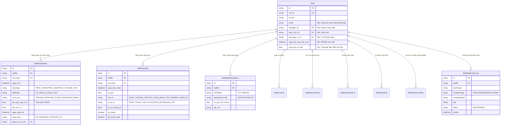

# 📋 KẾ HOẠCH NÂNG CẤP MODULE NHÂN SỰ (/staff)
## XÂY DỰNG "SỔ QUẢN LÝ LAO ĐỘNG ĐIỆN TỬ" & HỆ THỐNG CHẤM CÔNG - CHẤM TRỰC - THÊM GIỜ BỆNH VIỆN
### Căn cứ pháp lý: Bộ luật Lao động 2019, Nghị định 145/2020/NĐ-CP & Quyết định 73/2011/QĐ-TTg
**Đơn vị áp dụng:** Bệnh viện Đa khoa Lạng Sơn (Quy mô ~1.500 Cán bộ Nhân viên)

---

## 1. TỔNG QUAN & CĂN CỨ PHÁP LÝ

1. **Bộ luật Lao động 2019 (Điều 12, 107, 115)** & **Nghị định 145/2020/NĐ-CP (Điều 3)**:
   - Quy định 20 tiêu chí bắt buộc trong Sổ quản lý lao động điện tử.
   - Quy định trần giờ làm thêm: tối đa 40 giờ/tháng và không quá 200 - 300 giờ/năm (ngành y tế cấp cứu, chống dịch).
2. **Quyết định 73/2011/QĐ-TTg của Thủ tướng Chính phủ**:
   - Quy định chế độ phụ cấp trực 24/24h, trực 16h/12h đối với cơ sở y tế công lập.
   - Phân định rõ chế độ: **Trực chính (Trực bình thường)**, **Trực kèm (Trực phụ/tập sự)** và **Trực thường trú (On-call)**, cùng chế độ nghỉ bù và phụ cấp tiền ăn ca trực.
3. **Cơ chế Thông báo Biến động qua Email**:
   - Tự động gửi thông báo đến Email cá nhân người lao động và Trưởng khoa phòng khi có biến động về hồ sơ, lịch trực, ngày nghỉ phép, giờ làm thêm và quyết định khen thưởng/kỷ luật.

---

## 2. BẢNG ĐỐI SOÁT HIỆN TRẠNG 20 TIÊU CHÍ LUẬT ĐỊNH

| STT | Tiêu chí theo Nghị định 145/2020/NĐ-CP | Hiện trạng tại Codebase `/staff` | Đánh giá | Giải pháp kỹ thuật bổ sung |
| :---: | :--- | :--- | :---: | :--- |
| **1** | **Họ và tên** | Có trường `Staff.ho_ten` | ✅ Đầy đủ | Duy trì hiện trạng |
| **2** | **Giới tính** | Có `Staff.gioi_tinh_id` (`SystemCategory`) | ✅ Đầy đủ | Duy trì hiện trạng |
| **3** | **Ngày tháng năm sinh** | Có `Staff.ngay_sinh` | ✅ Đầy đủ | Duy trì hiện trạng |
| **4** | **Quốc tịch** | Chưa có trường quốc tịch trong `Staff` | ❌ Thiếu | Thêm `quoc_tich_id` (liên kết `SystemCategory` TYPE='QUOC_GIA', mặc định Việt Nam) |
| **5** | **Nơi cư trú** | Đã có: `dia_chi`, `noi_o_ward_id`, `noi_o_thon`, `que_quan_...`, `noi_sinh_...` | ⚠️ Đạt 80% | Chuẩn hóa rõ 3 nhóm: Thường trú, Tạm trú, Nơi ở hiện tại |
| **6** | **Số CCCD / CMND / Hộ chiếu** | Có `Staff.cccd`, `ngay_cap_cccd`, `noi_cap_cccd` | ⚠️ Đạt 85% | Bổ sung `loai_giay_to_id` (CCCD có gắn chip, Hộ chiếu, CMND 9/12 số) |
| **7** | **Trình độ chuyên môn kỹ thuật** | Có `Staff.trinh_do_id` & CCHN y tế (`PracticingCertificate`) | ✅ Đầy đủ | Bổ sung Chuyên ngành đào tạo chi tiết |
| **8** | **Bậc trình độ kỹ năng nghề** | Có `chuc_danh_id` (Chức danh nghề nghiệp y tế) | ⚠️ Đạt 60% | Thêm trường `bac_ky_nang_nghe_id` (Chứng chỉ kỹ năng nghề quốc gia / Hạng tay nghề) |
| **9** | **Vị trí việc làm** | Có `Staff.vi_tri_viec_lam_id` | ✅ Đầy đủ | Duy trì hiện trạng |
| **10** | **Loại hợp đồng lao động** | Chỉ có 1 trường `loai_hop_dong_id` trên `Staff` | ⚠️ Thiếu lịch sử | **Tạo bảng `StaffContract`**: Quản lý nhiều HĐ (HĐ thử việc -> Có thời hạn -> Không thời hạn), số HĐ, ngày ký, ngày hết hạn, file đính kèm |
| **11** | **Thời điểm bắt đầu làm việc** | Có `ngay_tuyen_dung`, `so_qd_tuyen_dung` | ⚠️ Đạt 70% | Chuẩn hóa trường `ngay_bat_dau_lam_viec` (tính thâm niên từ ngày thử việc/học việc) |
| **12** | **Tham gia Bảo hiểm xã hội** | Có `ma_bhxh` | ⚠️ Thiếu quá trình | Thêm `ngay_tham_gia_bhxh`, `trang_thai_bhxh` (Đang đóng, Tạm hoãn, Đã chốt sổ), `muc_luong_dong_bhxh` |
| **13** | **Tiền lương** | Có ngạch, bậc, hệ số, phụ cấp thâm niên vượt khung | ⚠️ Thiếu phụ cấp y tế | Thêm mức lương cơ sở/lương thỏa thuận, các phụ cấp ngành y: Ưu đãi nghề (20-100%), Phụ cấp độc hại, Phụ cấp chức vụ |
| **14** | **Nâng bậc, nâng lương** | Chỉ có 1 ngày `thoi_diem_nang_luong` | ⚠️ Thiếu lịch sử | **Tạo bảng `StaffSalaryHistory`**: Lưu toàn bộ lịch sử các lần nâng bậc, nâng ngạch, nâng lương trước thời hạn, số QĐ, mốc nâng kỳ tới |
| **15** | **Số ngày nghỉ trong năm** | Chỉ có bảng `StaffAttendance` theo từng ngày | ❌ Chưa có bảng phép | **Tạo bảng `StaffLeaveBalance` & `StaffLeaveRecord`**: Quản lý Quỹ phép năm (12-16 ngày), số ngày đã nghỉ, nghỉ ốm BHYT, thai sản, nghỉ việc riêng |
| **16** | **Số giờ làm thêm** | Chưa có | ❌ Thiếu | **Tạo bảng `StaffOvertime`**: Ghi nhận giờ làm thêm ngoài giờ, kíp mổ phiên, ca đêm, ngày lễ Tết theo BLLĐ |
| **17** | **Đào tạo, bồi dưỡng, nâng cao tay nghề** | Đã có model `StaffTraining` đơn giản | ⚠️ Cần mở rộng | Bổ sung: CME Y khoa liên tục (tín chỉ/giờ đào tạo), hình thức đào tạo, kinh phí, cam kết phục vụ sau đào tạo |
| **18** | **Kỷ luật lao động, trách nhiệm vật chất** | Chưa có | ❌ Thiếu | **Tạo bảng `StaffDiscipline`**: Hình thức kỷ luật (Khiển trách, Cảnh cáo, Kéo dài nâng lương, Sa thải), bồi thường thiệt hại thiết bị/vật tư y tế |
| **19** | **Tai nạn lao động, bệnh nghề nghiệp** | Chưa có | ❌ Thiếu | **Tạo bảng `StaffLaborAccident`**: Ghi nhận sự cố y tế (phơi nhiễm nghề nghiệp, tai nạn rủi ro), tỷ lệ suy giảm KNLĐ (%), chế độ trợ cấp |
| **20** | **Thời điểm chấm dứt HĐLĐ & Lý do** | Chỉ có trạng thái làm việc chung chung | ⚠️ Thiếu thủ tục | Thêm `ngay_cham_dut_hd`, `so_qd_thoi_viec`, `ly_do_cham_dut_id` (Nghỉ hưu, Chuyển công tác, Đơn phương chấm dứt, Hết hạn...), ngày trả sổ BHXH |

---

## 3. THIẾT KẾ BỘ BA PHÂN HỆ: CHẤM CÔNG - CHẤM TRỰC - THÊM GIỜ (ĐẶC THÙ BỆNH VIỆN)

Đặc thù bệnh viện đòi hỏi quản lý độc lập nhưng liên kết chặt chẽ 3 bảng biểu sau:

```
┌────────────────────────────────────────────────────────────────────────┐
│                    HỆ THỐNG THỜI CÔNG Y TẾ BỆNH VIỆN                   │
├──────────────────┬─────────────────────────────┬───────────────────────┤
│ 1. BẢNG CHẤM CÔNG│ 2. BẢNG CHẤM TRỰC LÂM SÀNG  │ 3. BẢNG THÊM GIỜ (OT) │
│    HÀNH CHÍNH    │    (Theo QĐ 73/2011/QĐ-TTg) │    (Theo BLLĐ 2019)   │
├──────────────────┼─────────────────────────────┼───────────────────────┤
│ • Công ngày (X)  │ • Trực bình thường (Chính)  │ • Làm thêm ngày thường│
│ • Nghỉ phép (P)  │ • Trực kèm (Phụ/Tập sự)     │ • Làm thêm cuối tuần  │
│ • Nghỉ ốm (Ô)    │ • Trực thường trú (On-call) │ • Làm thêm Lễ/Tết     │
│ • Thai sản (TS)  │ • Nghỉ bù sau trực          │ • Kéo dài ca mổ/CC    │
│ • Hội nghị/CT    │ • Phụ cấp tiền ăn ca trực   │ • Cảnh báo trần 300h  │
└──────────────────┴─────────────────────────────┴───────────────────────┘
```

### 3.1. Phân hệ 1: Bảng Chấm Công Hành Chính (Monthly Timesheet)
- **Mục tiêu**: Chấm công thời gian làm việc tiêu chuẩn (8 giờ/ngày, 22-26 ngày công/tháng).
- **Mã ký hiệu công chuẩn Bộ Y tế**:
  - `X`: Đi làm đủ ngày (8 tiếng) | `X/2`: Làm nửa ngày (4 tiếng).
  - `P`: Nghỉ phép năm có lương (trừ vào Quỹ phép năm).
  - `Ô`: Nghỉ ốm đau hưởng trợ cấp BHXH (không hưởng lương viện).
  - `TS`: Nghỉ chế độ thai sản 6 tháng theo luật BHXH.
  - `VR`: Nghỉ việc riêng có hưởng lương (kết hôn 3 ngày, tang chế 3 ngày...).
  - `KL`: Nghỉ không hưởng lương (đã có đơn duyệt của Trưởng khoa).
  - `CT`: Đi công tác, tham gia hội chẩn ngoại viện hoặc đào tạo bồi dưỡng.
- **Bảng CSDL**: `StaffDailyAttendance` (Lưu từng ngày của tháng) và `StaffMonthlyTimesheet` (Chốt tổng công cuối tháng).

### 3.2. Phân hệ 2: Bảng Chấm Trực Lâm Sàng (Hospital Duty Roster) - QĐ 73/2011/QĐ-TTg
Bệnh viện hoạt động 24/7/365 nên công trực là phân hệ đặc thù quan trọng nhất:
- **Phân loại 3 hình thức trực y tế**:
  1. **Trực bình thường (Trực chính / Trực 24/24h hoặc Trực 16h/12h)**:
     - Dành cho Bác sĩ trưởng kíp, Bác sĩ khám cấp cứu, Điều dưỡng trực chính buồng bệnh.
     - Chế độ: Hưởng **100% phụ cấp trực** theo hạng bệnh viện + **Hỗ trợ tiền ăn ca trực** + **Được nghỉ bù** ngày hôm sau.
  2. **Trực kèm (Trực phụ / Bác sĩ - Điều dưỡng tập sự / Kíp học việc)**:
     - Dành cho nhân sự mới tuyển dụng đang tập sự, học viên chuyển giao kỹ thuật hoặc người thứ 2 trong kíp trực đông bệnh nhân.
     - Chế độ: Hưởng **mức phụ cấp trực kèm** (50% hoặc theo Quy chế chi tiêu nội bộ của BV), được ghi nhận số buổi trực kèm để làm điều kiện hoàn thành tập sự và cấp Chứng chỉ hành nghề.
  3. **Trực thường trú (On-call / Trực ngoại viện)**:
     - Bác sĩ/Phẫu thuật viên trực tại nhà, luôn mở máy điện thoại, cam kết có mặt tại phòng mổ/cấp cứu trong vòng **15 - 30 phút** khi có báo động đỏ.
     - Chế độ: Phụ cấp trực thường trú theo quy định.
- **Bảng CSDL**: `StaffDutyRoster`
  - `dutyType`: `TRUC_CHINH` | `TRUC_KEM` | `TRUC_THUONG_TRU`.
  - `shiftType`: `24H` (7h30 -> 7h30 hôm sau) | `16H` (16h30 -> 7h30) | `12H`.
  - `positionInShift`: Trưởng kíp, Bác sĩ điều trị, Điều dưỡng chăm sóc, KTV xét nghiệm/CĐHA.
  - `allowanceAmount`: Số tiền phụ cấp trực tự động tính theo ngạch bậc/QĐ 73.
  - `mealAllowance`: Tiền ăn ca trực.
  - `compLeaveDate`: Ngày được xếp nghỉ bù sau trực.

### 3.3. Phân hệ 3: Bảng Chấm Thêm Giờ (Overtime - Làm ngoài giờ)
- **Căn cứ**: Điều 107 Bộ luật Lao động 2019.
- **Phân loại giờ làm thêm y tế**:
  - `OT_NORMAL`: Làm thêm ngày làm việc bình thường (Hưởng **150%** đơn giá giờ).
  - `OT_WEEKEND`: Làm thêm ngày nghỉ hàng tuần Thứ 7, Chủ Nhật (Hưởng **200%** đơn giá giờ).
  - `OT_HOLIDAY`: Làm thêm ngày Lễ, Tết (Hưởng **300%** đơn giá giờ chưa kể lương ngày lễ).
  - `OT_NIGHT`: Làm việc ban đêm (từ 22h00 đêm đến 06h00 sáng hôm sau): Cộng thêm ít nhất **30%** lương ca ngày.
- **Cơ chế Cảnh báo Trần giờ làm thêm tự động**:
  - Cảnh báo vàng: Khi nhân viên đạt **150 giờ làm thêm/năm**.
  - Cảnh báo đỏ: Khi nhân sự chạm ngưỡng **200 giờ/năm** (mức trần chung) hoặc **300 giờ/năm** (mức trần tối đa ngành Y theo thỏa thuận). Hệ thống cảnh báo Trưởng khoa không được xếp thêm giờ để tránh vi phạm thanh tra lao động.

---

## 4. HỆ THỐNG THÔNG BÁO TỰ ĐỘNG BIẾN ĐỘNG QUA EMAIL (AUTOMATED EMAIL ALERT)

### 4.1. Đối tượng thụ hưởng thông báo
1. **Cá nhân người lao động (`Staff.email`)**:
   - Nhận thông báo bảng trực phân công đầu tháng / hàng tuần.
   - Nhận thông báo phê duyệt ngày nghỉ phép, giờ làm thêm, quyết định nâng lương, khen thưởng, kỷ luật.
2. **Người quản lý trực tiếp / Trưởng khoa phòng (`Staff.manager_id` hoặc Trưởng khoa `Department`)**:
   - Nhận thông báo khi nhân sự thuộc khoa có biến động (điều chuyển khoa, nghỉ ốm/phép, sự cố tai nạn lao động, nhân sự chạm trần giờ làm thêm).
3. **Phòng Tổ chức cán bộ & Ban Giám đốc**:
   - Nhận báo cáo tổng hợp biến động toàn viện, cảnh báo nhân sự vượt giờ làm thêm quy định.

### 4.2. Ma trận Sự Kiện Kích Hoạt Email

| Mã sự kiện | Tên biến động nhân sự | Gửi Người LĐ (`Staff.email`) | Gửi Quản lý Khoa (`Manager`) | Gửi Phòng TCCB | Nội dung Email tóm tắt |
| :--- | :--- | :---: | :---: | :---: | :--- |
| `DUTY_SCHEDULE_PUBLISHED`| Ban hành Bảng phân ca trực tháng | ✅ | ✅ | - | Lịch trực chi tiết (Trực chính, Trực kèm, Ca trực, Ngày nghỉ bù) |
| `OVERTIME_ALERT_LIMIT` | Cảnh báo chạm trần giờ làm thêm (200h/300h)| ✅ | ✅ | ✅ | Cảnh báo số giờ làm thêm đã tích lũy trong năm, khuyến nghị điều phối |
| `CONTRACT_CHANGE` | Ký mới / Gia hạn HĐLĐ / Sắp hết hạn | ✅ | ✅ | ✅ | Số HĐ, loại HĐ, thời hạn từ ngày - đến ngày, file đính kèm |
| `SALARY_CHANGE` | Quyết định Nâng bậc / Nâng lương | ✅ | ✅ | - | Số QĐ, ngạch bậc mới, hệ số mới, ngày áp dụng, mốc nâng kỳ tới |
| `DEPT_TRANSFER` | Luân chuyển / Điều động Khoa phòng | ✅ | ✅ (Khoa đi & Khoa đến) | ✅ | Số QĐ điều động, Khoa cũ -> Khoa mới, Chức vụ mới, ngày nhận việc |
| `LEAVE_RECORD` | Ghi nhận / Phê duyệt Nghỉ phép, Nghỉ ốm | ✅ | ✅ | - | Loại nghỉ, từ ngày - đến ngày, số ngày nghỉ, số ngày phép năm còn lại |
| `DISCIPLINE_ALERT` | Kỷ luật / Trách nhiệm bồi thường vật chất | ✅ | ✅ | ✅ | Số QĐ kỷ luật, hình thức xử lý, trách nhiệm bồi thường hỏng hóc thiết bị |
| `ACCIDENT_ALERT` | Tai nạn lao động / Phơi nhiễm y tế | ✅ | ✅ | ✅ | Ngày xảy ra, loại sự cố phơi nhiễm, phác đồ điều trị, tỷ lệ suy giảm KNLĐ |
| `TERMINATION` | Chấm dứt HĐLĐ / Nghỉ hưu / Chuyển CT | ✅ | ✅ | ✅ | Số QĐ thôi việc, ngày nghỉ, lý do chấm dứt, ngày bàn giao & trả sổ BHXH |

---

## 5. THIẾT KẾ CSDL CHI TIẾT (ADDITIVE-ONLY)



---

## 6. GIAO DIỆN NGƯỜI DÙNG & TÍNH NĂNG XUẤT BÁO CÁO (UI/UX)

1. **Tab Quản lý Chấm công & Trực trên `/staff`**:
   - **Lưới Chấm công tháng**: Bảng Ma trận 1 - 31 ngày trực quan, tô màu theo ký hiệu (`X` xanh lá, `P` vàng, `Ô` cam, `TS` tím).
   - **Lưới Chấm trực lâm sàng**: Hiển thị rõ danh sách ca trực theo từng ngày của Khoa, phân biệt rõ cột **Trực chính** và **Trực kèm (phụ)**, hỗ trợ nút "Đổi ca trực" có xác nhận qua email.
   - **Bảng theo dõi giờ làm thêm (Overtime KPI)**: Thanh Progress Bar hiển thị % giờ làm thêm đã dùng so với hạn mức 200h/300h trong năm của từng bác sĩ/điều dưỡng.

2. **Xuất Báo Cáo Chuẩn Quy Định**:
   - **Sổ Quản Lý Lao Động (Nghị định 145/2020/NĐ-CP)**: Xuất file Excel 20 cột đầy đủ.
   - **Bảng tổng hợp thanh toán phụ cấp trực theo QĐ 73/2011/QĐ-TTg**: Tự động tính tiền trực chính, trực kèm, tiền ăn ca để chuyển Phòng Tài chính Kế toán thanh toán.
   - **Bảng thanh toán tiền lương làm thêm giờ (Mẫu C13-HD)**.

---

## 7. LỘ TRÌNH THỰC HIỆN CHI TIẾT (4 BƯỚC)

- **Bước 1: Mở rộng CSDL Prisma & Dịch vụ Email**:
  - Bổ sung `StaffDutyRoster`, `StaffOvertime`, `StaffDailyAttendance`, `StaffNotificationLog` và các trường mới trong `Staff`.
  - Cài đặt `nodemailer` và cấu hình mẫu Email gửi lịch trực, chốt công và cảnh báo giờ làm thêm.
- **Bước 2: Xây dựng Backend APIs**:
  - API Chấm công tháng & Chốt công khoa phòng.
  - API Xếp lịch trực & Chấm trực (phân biệt trực chính, trực kèm, trực thường trú).
  - API Ghi nhận & Kiểm soát trần giờ làm thêm Overtime.
- **Bước 3: Nâng cấp Giao diện Web `/staff`**:
  - Nâng cấp Modal chi tiết hồ sơ 360° với Tab Chấm công - Trực - Thêm giờ.
  - Tích hợp gửi email tức thời khi xếp lịch trực hoặc duyệt công.
- **Bước 4: Xuất báo cáo Excel & Kiểm thử thực tế**:
  - Xuất Excel Sổ Quản lý lao động, Bảng phụ cấp trực QĐ 73, Bảng làm thêm giờ.
  - Soạn tài liệu Hướng dẫn sử dụng chi tiết.
