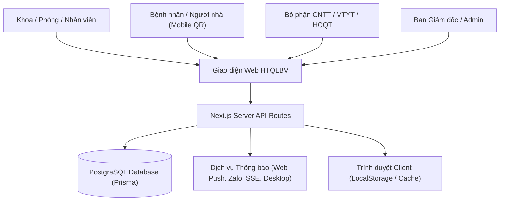
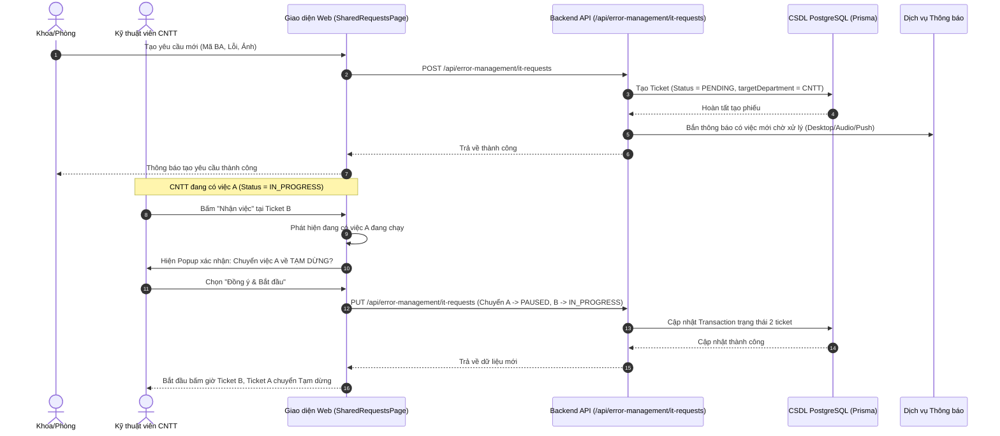
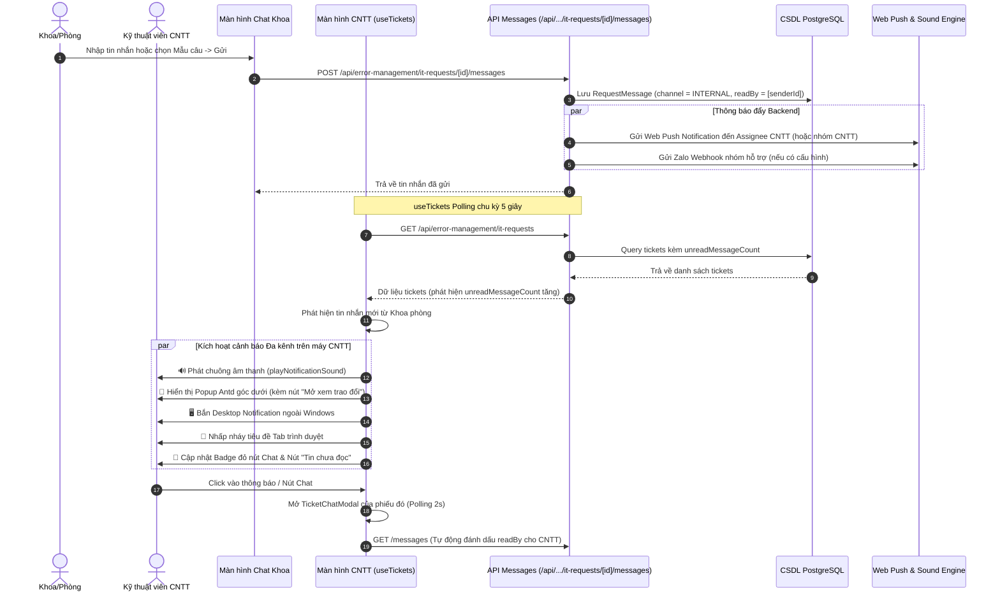
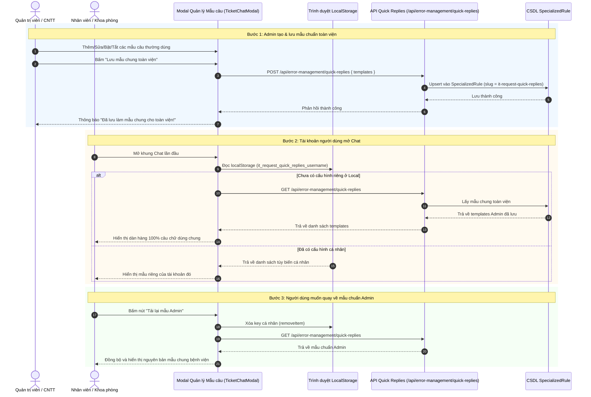
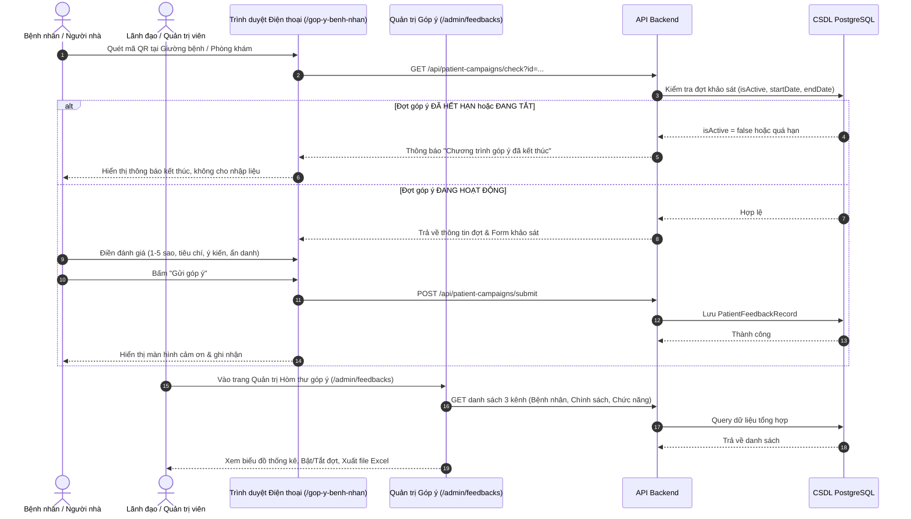
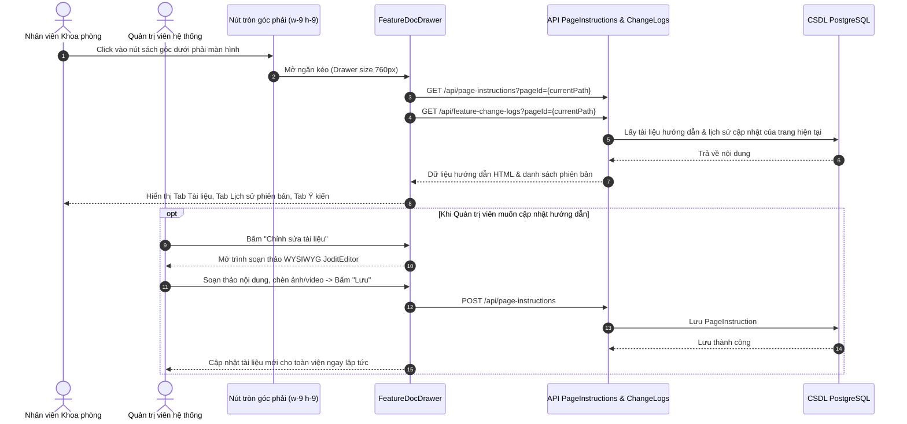

# 🏥 TÀI LIỆU KIẾN TRÚC TÍNH NĂNG & BIỂU ĐỒ TRÌNH TỰ (SEQUENCE DIAGRAMS)
### Hệ thống Quản trị & Quản lý Chất lượng Bệnh viện Đa khoa Lạng Sơn

---

## 📑 MỤC LỤC
1. [Tổng quan Hệ thống Phân hệ](#1-tổng-quan-hệ-thống-phân-hệ)
2. [Bảng Tổng hợp Tất cả Tính năng Hệ thống](#2-bảng-tổng-hợp-tất-cả-tính-năng-hệ-thống)
3. [Sequence Diagram Chi tiết từng Chức năng](#3-sequence-diagram-chi-tiết-từng-chức-năng)
   - [3.1. Quy trình Tiếp nhận & Xử lý Yêu cầu CNTT (1 Việc tập trung)](#31-quy-trình-tiếp-nhận--xử-lý-yêu-cầu-cntt-1-việc-tập-trung)
   - [3.2. Quy trình Chat Trao đổi & Cảnh báo Tin nhắn Thời gian thực](#32-quy-trình-chat-trao-đổi--cảnh-báo-tin-nhắn-thời-gian-thực)
   - [3.3. Quy trình Mẫu câu Trả lời Nhanh (Dùng chung CSDL + Tùy biến Cá nhân)](#33-quy-trình-mẫu-câu-trả-lời-nhanh-dùng-chung-csdl--tùy-biến-cá-nhân)
   - [3.4. Quy trình Hòm thư Góp ý Đa kênh (Bệnh nhân QR, Chính sách, Chức năng)](#34-quy-trình-hòm-thư-góp-ý-đa-kênh-bệnh-nhân-qr-chính-sách-chức-năng)
   - [3.5. Quy trình Tủ sách Hướng dẫn & Quản lý Thay đổi (FeatureDocDrawer)](#35-quy-trình-tủ-sách-hướng-dẫn--quản-lý-thay-đổi-featuredocdrawer)
4. [Kế hoạch Phát triển & Vận hành Tiếp theo](#4-kế-hoạch-phát-triển--vận-hành-tiếp-theo)

---

## 1. TỔNG QUAN HỆ THỐNG PHÂN HỆ

Hệ thống được thiết kế theo kiến trúc hiện đại **Next.js App Router + TypeScript + TailwindCSS + Ant Design**, kết nối CSDL **PostgreSQL qua Prisma ORM**:

---

## 2. BẢNG TỔNG HỢP TẤT CẢ TÍNH NĂNG HỆ THỐNG

| STT | Phân hệ | Tên tính năng | Đối tượng sử dụng | Mô tả chức năng |
| :---: | :--- | :--- | :--- | :--- |
| **I** | **Quản lý Yêu cầu CNTT & Kỹ thuật** | **Tạo & Gửi yêu cầu hỗ trợ** | Khoa/Phòng | Nhập mã bệnh án, chọn lỗi thường gặp hoặc gõ nội dung, đính kèm ảnh, tự động điền SĐT người báo. |
| 2 | | **Tiếp nhận 1 việc tập trung** | Kỹ thuật viên CNTT | Khi nhận 1 phiếu mới, phiếu đang xử lý cũ tự động chuyển sang **Tạm dừng** để tránh phân tán việc. |
| 3 | | **Trao đổi Chat đa kênh** | Khoa/Phòng, CNTT, Đối tác ngoài | 2 kênh riêng biệt: Kênh Nội bộ (Khoa - CNTT) và Kênh Đối tác phần mềm (VNPT, Viettel, FPT...). |
| 4 | | **Mẫu câu trả lời nhanh** | Admin, CNTT, Khoa/Phòng | Admin khai báo mẫu chung toàn viện (CSDL); Từng tài khoản tự lưu mẫu riêng; Hỗ trợ Bật/Tắt, dàn hàng 100% câu chữ. |
| 5 | | **Cảnh báo thời gian thực** | CNTT | Chuông âm thanh + Popup góc màn hình + Desktop Windows Notification + Nhấp nháy Tab + Web Push. |
| 6 | | **Bộ lọc thông minh** | Mọi tài khoản | Lọc trạng thái, lọc theo ngày, nút **Tin chưa đọc** (huy hiệu đỏ), Dropdown chuyển chế độ xem (Tự động/Thẻ/Bảng). |
| 7 | | **Việc gửi ngoài (Vendor Ticket)** | CNTT, Điều phối | Quản lý phiếu gửi đối tác xử lý, hẹn ngày trả kết quả, đồng bộ mã ticket hãng. |
| **II** | **Hòm thư Góp ý 3 Kênh** | **Kênh 1: Góp ý Chức năng phần mềm** | Cán bộ nhân viên | Gửi phản ánh/lỗi phần mềm đang dùng, đính kèm file/ảnh; Admin phản hồi tiếp thu hoặc giải trình. |
| 9 | | **Kênh 2: Góp ý Văn bản & Chính sách** | Khoa/Phòng | Đăng tải dự thảo quy định, kiểm tra hạn góp ý (`endDate`, `isActive`); Khoa phòng đọc văn bản và gửi góp ý. |
| 10 | | **Kênh 3: Góp ý Người bệnh qua QR** | Bệnh nhân / Thân nhân | Quét mã QR tại buồng bệnh/phòng khám trên điện thoại; Tự động kiểm tra đợt khảo sát còn hiệu lực mới cho gửi. |
| 11 | | **Quản trị hòm thư & Xuất Excel** | Lãnh đạo, Admin | 3 Tabs quản lý tập trung, thống kê mức độ hài lòng, quản lý mã QR, tải báo cáo Excel đầy đủ. |
| **III** | **Tủ sách Hướng dẫn & Quản lý Thay đổi** | **Tủ sách hướng dẫn sử dụng** | Toàn viện | Nút nổi góc màn hình; Xem tài liệu hướng dẫn chuẩn hóa của từng màn hình; Admin soạn thảo bằng JoditEditor. |
| 13 | | **Nhật ký thay đổi (Change Logs)** | Toàn viện, Admin | Xem lịch sử các đợt cập nhật, tính năng mới, phiên bản phần mềm theo thời gian. |
| **IV** | **Giám sát BHYT & Hồ sơ XML** | **Kiểm tra trùng lặp BHYT** | Tổ BHYT, KHTH | Phát hiện trùng lặp bác sĩ khám, trùng giường, chỉ định trùng dịch vụ kỹ thuật theo Quyết định 130/QĐ-BYT. |
| 15 | | **Khám sức khỏe toàn dân** | Phòng KSK, Đối tác | Cổng tra cứu, import danh sách cơ quan, quản lý hồ sơ khám sức khỏe định kỳ. |

---

## 3. SEQUENCE DIAGRAM CHI TIẾT TỪNG CHỨC NĂNG

### 3.1. Quy trình Tiếp nhận & Xử lý Yêu cầu CNTT (1 Việc tập trung)

---

### 3.2. Quy trình Chat Trao đổi & Cảnh báo Tin nhắn Thời gian thực

---

### 3.3. Quy trình Mẫu câu Trả lời Nhanh (Dùng chung CSDL + Tùy biến Cá nhân)

---

### 3.4. Quy trình Hòm thư Góp ý Đa kênh (Bệnh nhân QR, Chính sách, Chức năng)

---

### 3.5. Quy trình Tủ sách Hướng dẫn & Quản lý Thay đổi (FeatureDocDrawer)

---

## 4. KẾ HOẠCH PHÁT TRIỂN & VẬN HÀNH TIẾP THEO

### Giai đoạn 1: Ổn định & Tối ưu hóa Hiện tại (Tuần 1)
- [x] Đã khôi phục thanh bộ lọc 1 hàng chuẩn kèm nút Dropdown thông minh.
- [x] Đã hoàn thành Mẫu câu trả lời nhanh CSDL + LocalStorage + Dàn hàng 100%.
- [x] Đã tích hợp chuông báo, popup, desktop notification và nhấp nháy tab khi có tin nhắn từ Khoa.
- [x] Đã thu nhỏ nút Tủ sách hướng dẫn (36px) và xóa cảnh báo Ant Design `Spin tip`.
- [ ] Tập huấn ngắn cho tổ Kỹ thuật CNTT về thao tác 1 việc tập trung và sử dụng mẫu câu trả lời nhanh.

### Giai đoạn 2: Báo cáo & Đánh giá Hiệu năng KPI (Tuần 2 - 3)
- [ ] Xây dựng Dashboard thống kê thời gian phản hồi trung bình (SLA) của từng kỹ thuật viên CNTT.
- [ ] Báo cáo tỷ lệ hài lòng của các Khoa phòng đối với dịch vụ hỗ trợ của CNTT.
- [ ] Tích hợp tính năng đánh giá sao (1 - 5 sao) trực tiếp khi Khoa phòng bấm xác nhận hoàn thành phiếu hỗ trợ.

### Giai đoạn 3: Mở rộng Đa nền tảng & Tự động hóa (Tháng tiếp theo)
- [ ] Tích hợp Zalo ZNS / Mini App gửi thông báo tự động cho bệnh nhân sau khi xuất viện để lấy ý kiến đóng góp.
- [ ] Gửi báo cáo tổng hợp sự cố CNTT hàng tuần tự động vào email Ban Giám đốc và Lãnh đạo phòng CNTT.
