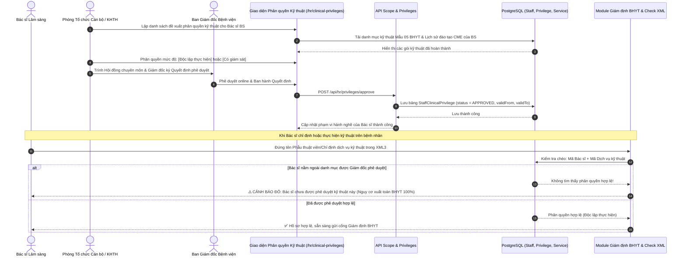
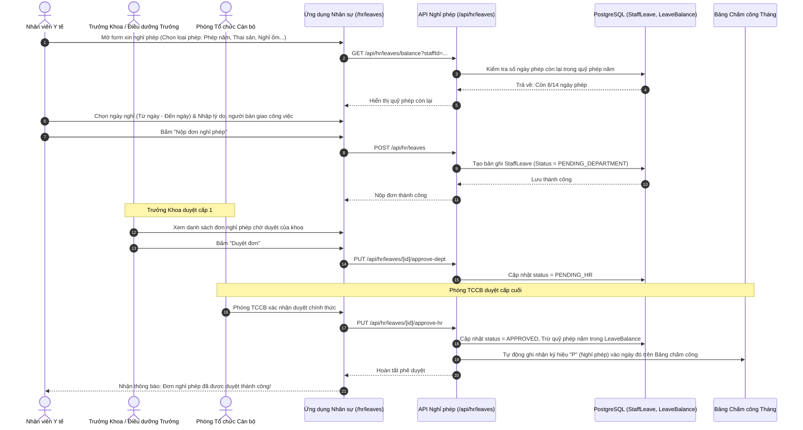
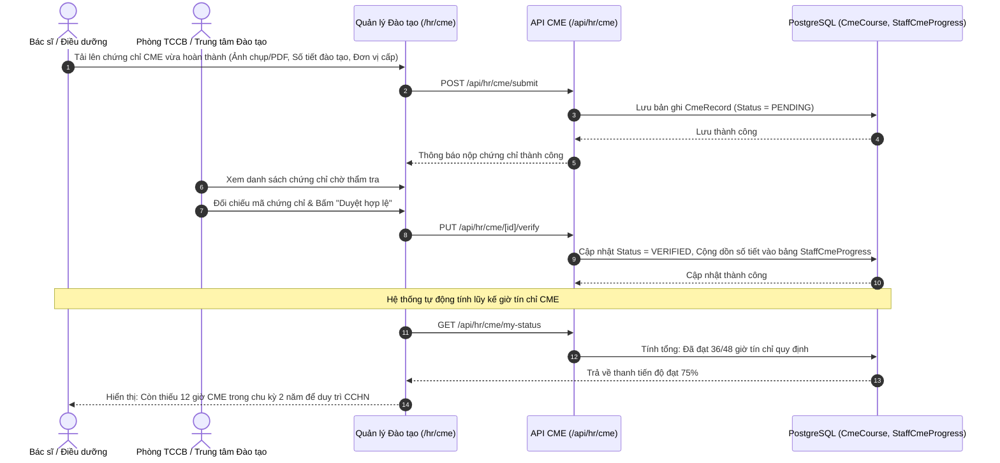
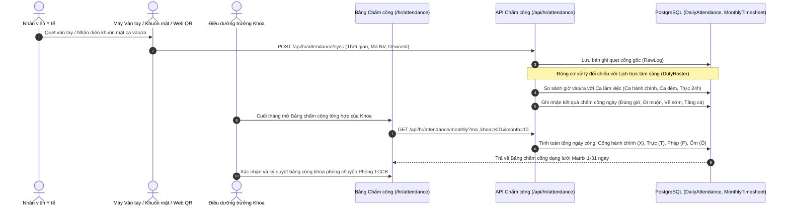
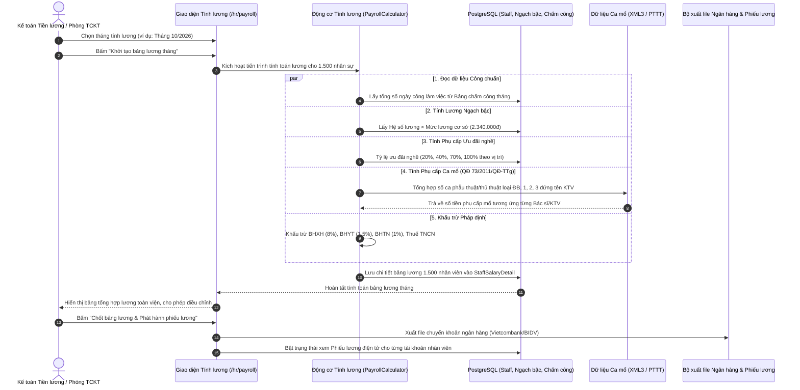

# 👥 TÀI LIỆU THIẾT KẾ KIẾN TRÚC & KẾ HOẠCH PHÁT TRIỂN PHÂN HỆ QUẢN TRỊ NHÂN SỰ (HRM)
### Bệnh viện Đa khoa Lạng Sơn (Quy mô 1.500 Cán bộ Nhân viên)

---

## 📌 MỤC LỤC
1. [Đánh giá Năng lực Hệ thống & Hiện trạng Có sẵn](#1-đánh-giá-năng-lực-hệ-thống--hiện-trạng-có-sẵn)
2. [Sequence Diagrams Chi tiết Các Quy trình Nghiệp vụ Cốt lõi](#2-sequence-diagrams-chi-tiết-các-quy-trình-nghiệp-vụ-cốt-lõi)
   - [2.1. Quy trình Quản lý Phạm vi Hành nghề & Phân quyền Kỹ thuật Lâm sàng (Chống xuất toán BHYT)](#21-quy-trình-quản-lý-phạm-vi-hành-nghề--phân-quyền-kỹ-thuật-lâm-sàng-chống-xuất-toán-bhyt)
   - [2.2. Quy trình Nộp & Phê duyệt Đơn Nghỉ phép Trực tuyến (Leave Management)](#22-quy-trình-nộp--phê-duyệt-đơn-nghỉ-phép-trực-tuyến-leave-management)
   - [2.3. Quy trình Đào tạo Y khoa liên tục (CME) & Bồi dưỡng Chuyên môn](#23-quy-trình-đào-tạo-y-khoa-liên-tục-cme--bồi-dưỡng-chuyên-môn)
   - [2.4. Quy trình Chấm công Phân ca Lâm sàng & Kíp trực 24/24](#24-quy-trình-chấm-công-phân-ca-lâm-sàng--kíp-trực-2424)
   - [2.5. Quy trình Tính Lương Ngạch bậc & Phụ cấp Phẫu thuật - Thủ thuật (QĐ 73/2011)](#25-quy-trình-tính-lương-ngạch-bậc--phụ-cấp-phẫu-thuật---thủ-thuật-qđ-732011)
3. [Kế hoạch Phát triển Riêng cho Từng Module (Individual Roadmap)](#3-kế-hoạch-phát-triển-riêng-cho-từng-module-individual-roadmap)
   - [Module 1: Hồ sơ Nhân sự 360° & Hợp đồng Lao động (`HR-PROFILE`)](#module-1-hồ-sơ-nhân-sự-360-v-hợp-đồng-lao-động-hr-profile)
   - [Module 2: Quản lý Phạm vi Hành nghề & Phân quyền Kỹ thuật (`HR-PRIVILEGES`)](#module-2-quản-lý-phạm-vi-hành-nghề--phân-quyền-kỹ-thuật-hr-privileges)
   - [Module 3: Đào tạo Y khoa Liên tục CME & Sau đại học (`HR-TRAINING`)](#module-3-đào-tạo-y-khoa-liên-tục-cme--sau-đại-học-hr-training)
   - [Module 4: Quản lý Chấm công & Phân ca kíp Y tế (`HR-ATTENDANCE`)](#module-4-quản-lý-chấm-công--phân-ca-kíp-y-tế-hr-attendance)
   - [Module 5: Quản lý Nghỉ phép Trực tuyến (`HR-LEAVE`)](#module-5-quản-lý-nghỉ-phép-trực-tuyến-hr-leave)
   - [Module 6: Tiền lương & Thu nhập Tăng thêm Ngành Y (`HR-PAYROLL`)](#module-6-tiền-lương--thu-nhập-tăng-thêm-ngành-y-hr-payroll)
4. [Nguyên tắc An toàn Mã nguồn & CSDL (Tuân thủ .cursorrules)](#4-nguyên-tắc-an-toàn-mã-nguồn--csdl-tuân-thủ-cursorrules)

---

## 1. ĐÁNH GIÁ NĂNG LỰC HỆ THỐNG & HIỆN TRẠNG CÓ SẴN

### 1.1. Khả năng chịu tải cho 1.500 nhân sự
- **Cơ sở dữ liệu PostgreSQL**: Hoàn toàn đáp ứng quy mô này với tốc độ phản hồi tính bằng mili-giây. Dữ liệu chấm công hàng tháng (~45.000 dòng/tháng) và dữ liệu lương (~1.500 dòng/tháng) hoàn toàn xử lý tức thì khi có Index.
- **Next.js App Router + Prisma ORM + Ant Design**: Hỗ trợ phân trang máy chủ (Server-side Pagination), xuất báo cáo ExcelJS hàng chục nghìn dòng không nghẽn bộ nhớ.

### 1.2. Nền tảng sẵn có trong Codebase
- Bảng `Staff`: Đã có thông tin hành chính, CCCD, BHYT, BHXH, ngạch lương, bậc lương, hệ số lương.
- Bảng `Department`: Quản lý 100% cơ cấu khoa/phòng bệnh viện.
- Bảng `PracticingCertificate`: Quản lý số chứng chỉ hành nghề y tế.
- Bảng `ScopeOfPracticeCatalog` (`/pham-vi-chuyen-mon`): Danh mục phạm vi chuyên môn & Map dịch vụ kỹ thuật Mẫu 05 BHYT.
- Bảng `DutyRoster` (`/clinical-scheduling`): Bảng xếp ca trực lâm sàng.
- Bảng `User`: Liên kết trực tiếp `staffId` để nhân viên đăng nhập bằng tài khoản cá nhân.

---

## 2. SEQUENCE DIAGRAMS CHI TIẾT CÁC QUY TRÌNH NGHIỆP VỤ CỐT LÕI

### 2.1. Quy trình Quản lý Phạm vi Hành nghề & Phân quyền Kỹ thuật Lâm sàng (Chống xuất toán BHYT)

---

### 2.2. Quy trình Nộp & Phê duyệt Đơn Nghỉ phép Trực tuyến (Leave Management)

---

### 2.3. Quy trình Đào tạo Y khoa liên tục (CME) & Bồi dưỡng Chuyên môn

---

### 2.4. Quy trình Chấm công Phân ca Lâm sàng & Kíp trực 24/24

---

### 2.5. Quy trình Tính Lương Ngạch bậc & Phụ cấp Phẫu thuật - Thủ thuật (QĐ 73/2011)

---

## 3. KẾ HOẠCH PHÁT TRIỂN RIÊNG CHO TỪNG MODULE (INDIVIDUAL ROADMAP)

### Module 1: Hồ sơ Nhân sự 360° & Hợp đồng Lao động (`HR-PROFILE`)
- **Mục tiêu**: Quản lý tập trung toàn diện 1.500 hồ sơ cán bộ nhân viên, quá trình công tác, hợp đồng lao động và theo dõi kỳ nâng bậc lương thường xuyên.
- **Dữ liệu Database (Prisma Models mới)**:
  - `StaffContract`: Quản lý hợp đồng (loại HĐ, ngày ký, ngày hết hạn, tệp scan PDF đính kèm).
  - `StaffFamilyMember`: Người phụ thuộc giảm trừ gia cảnh thuế TNCN.
  - `StaffWorkHistory`: Quá trình công tác, điều động, bổ nhiệm chức vụ.
  - Bổ sung trường optional vào `Staff`: `email`, `so_bhxh_so`, `avatar_url`.
- **API Endpoints**:
  - `GET/POST /api/hr/contracts`: Quản lý hợp đồng & tự động lọc hợp đồng sắp hết hạn (30 - 60 ngày).
  - `GET/POST /api/hr/salary-steps`: Lọc danh sách nhân viên đến hạn xét nâng lương thường xuyên.
- **Màn hình UI**:
  - `src/app/hr/staff/[id]`: Màn hình Hồ sơ 360° với Tabs `type="card"` trực quan.
- **Thời gian thực hiện**: Tuần 1 - Tuần 2.

---

### Module 2: Quản lý Phạm vi Hành nghề & Phân quyền Kỹ thuật (`HR-PRIVILEGES`)
- **Mục tiêu**: Phê duyệt danh mục kỹ thuật cho từng bác sĩ/điều dưỡng (thực hiện độc lập hay có giám sát), liên thông kiểm tra chéo với module Check XML BHYT để chống xuất toán.
- **Dữ liệu Database (Prisma Models mới)**:
  - `ClinicalPrivilegeDecision`: Quyết định phê duyệt danh mục kỹ thuật của Giám đốc (Số QĐ, ngày ban hành).
  - `StaffClinicalPrivilege`: Bảng phân quyền chi tiết (`staffId`, `ma_dich_vu`, `muc_do`: INDEPENDENT / SUPERVISED).
- **API Endpoints**:
  - `GET/POST /api/hr/privileges`: Lập và phê duyệt bảng phân quyền kỹ thuật.
  - `GET /api/hr/privileges/check-compliance`: API đối soát tức thì giữa Bác sĩ chỉ định trong XML3 và danh mục kỹ thuật được duyệt.
- **Màn hình UI**:
  - `src/app/hr/privileges`: Bảng ma trận phân quyền kỹ thuật dạng cây (Tree Table) theo phân nhóm chuyên khoa.
- **Thời gian thực hiện**: Tuần 2 - Tuần 3.

---

### Module 3: Đào tạo Y khoa Liên tục CME & Sau đại học (`HR-TRAINING`)
- **Mục tiêu**: Quản lý các khóa học, chứng chỉ CME bắt buộc hàng năm để duy trì chứng chỉ hành nghề, cảnh báo nhân viên chưa đủ giờ tín chỉ theo quy định Bộ Y tế.
- **Dữ liệu Database (Prisma Models mới)**:
  - `CmeCourse`: Khóa đào tạo (Tên khóa, đơn vị đào tạo, số giờ/tín chỉ CME, ngày hoàn thành).
  - Mở rộng `StaffTraining` có sẵn: Lưu số chứng chỉ, nơi cấp, đính kèm file ảnh chứng chỉ.
- **API Endpoints**:
  - `GET /api/hr/cme/summary`: Thống kê tổng số giờ tích lũy của từng nhân viên.
  - Cảnh báo tự động danh sách bác sĩ/điều dưỡng chưa hoàn thành chỉ tiêu giờ CME trong năm.
- **Màn hình UI**:
  - `src/app/hr/cme`: Dashboard hiển thị thanh tiến độ tích lũy tín chỉ CME cá nhân.
- **Thời gian thực hiện**: Tuần 3 - Tuần 4.

---

### Module 4: Quản lý Chấm công & Phân ca kíp Y tế (`HR-ATTENDANCE`)
- **Mục tiêu**: Chấm công tự động cho 1.500 nhân sự; hỗ trợ phân ca trực đặc thù 24/24, trực thường trú và ca kíp cấp cứu.
- **Dữ liệu Database (Prisma Models mới)**:
  - `AttendanceShift`: Danh mục ca làm việc (Hành chính, Ca ngày, Ca đêm, Trực 24h).
  - `StaffDailyAttendance`: Bản ghi chấm công ngày (`staffId`, `date`, `checkIn`, `checkOut`, `shiftId`, `status`).
  - `MonthlyTimesheet`: Bảng tổng hợp công tháng tự động tính tổng công làm việc.
- **API Endpoints**:
  - `POST /api/hr/attendance/sync`: Đồng bộ dữ liệu quẹt công từ máy chấm công vân tay / khuôn mặt.
  - `GET /api/hr/attendance/monthly`: Trả về bảng tổng hợp công toàn viện.
- **Màn hình UI**:
  - `src/app/hr/attendance`: Bảng chấm công dạng lưới Matrix 1-31 ngày trực quan.
- **Thời gian thực hiện**: Tuần 4 - Tuần 5.

---

### Module 5: Quản lý Nghỉ phép Trực tuyến (`HR-LEAVE`)
- **Mục tiêu**: Số hóa 100% quy trình xin nghỉ phép, tự động trừ quỹ phép năm và cập nhật trực tiếp vào bảng chấm công tháng.
- **Dữ liệu Database (Prisma Models mới)**:
  - `StaffLeave`: Đơn nghỉ phép (`staffId`, `leaveType`, `fromDate`, `toDate`, `daysCount`, `status`, `approverId`).
  - `LeaveBalance`: Quỹ phép năm (Phép tiêu chuẩn 12-16 ngày, phép thâm niên, phép đã nghỉ, phép còn lại).
- **API Endpoints**:
  - `POST /api/hr/leaves`: Tạo đơn xin nghỉ phép.
  - `PUT /api/hr/leaves/[id]/approve`: Phê duyệt đơn đa cấp (Trưởng khoa ➔ Phòng TCCB).
- **Màn hình UI**:
  - `src/app/hr/leaves`: Màn hình nộp đơn cá nhân và màn hình duyệt đơn cho Lãnh đạo khoa/phòng.
- **Thời gian thực hiện**: Tuần 5 - Tuần 6.

---

### Module 6: Tiền lương & Thu nhập Tăng thêm Ngành Y (`HR-PAYROLL`)
- **Mục tiêu**: Tính toán bảng thanh toán tiền lương 1.500 nhân sự minh bạch, chính xác từng khoản phụ cấp phẫu thuật/thủ thuật theo QĐ 73 và xuất phiếu lương điện tử bảo mật.
- **Dữ liệu Database (Prisma Models mới)**:
  - `PayrollPeriod`: Kỳ lương tháng (Tháng/Năm, mức lương cơ sở, trạng thái chốt bảng lương).
  - `StaffSalaryDetail`: Bảng chi tiết lương từng nhân sự (Lương ngạch bậc, phụ cấp ưu đãi nghề, phụ cấp PTTT theo QĐ 73, tiền trực, giảm trừ gia cảnh, thực lĩnh).
- **API Endpoints**:
  - `POST /api/hr/payroll/calculate`: Kích hoạt động cơ tính lương tự động cho toàn viện.
  - `GET /api/hr/payroll/my-payslip`: Nhân viên tự tra cứu phiếu lương bảo mật của mình trên di động/máy tính.
- **Màn hình UI**:
  - `src/app/hr/payroll`: Bảng tổng hợp lương toàn viện cho Phòng TCKT xuất file Excel ngân hàng.
- **Thời gian thực hiện**: Tuần 6 - Tuần 7.

---

## 4. NGUYÊN TẮC AN TOÀN MÃ NGUỒN & CSDL (TUÂN THỦ .CURSORRULES)
1. **Zero Regression & Isolation**: Toàn bộ mã nguồn mới của phân hệ HR được đặt trong thư mục độc lập `src/app/hr/...` và `src/app/api/hr/...`, hoàn toàn không chạm vào các chức năng khám chữa bệnh và BHYT hiện tại.
2. **An toàn Database (Prisma)**: Tất cả bảng CSDL mới được định nghĩa tách biệt. Nếu bổ sung trường vào model `Staff` cũ, 100% trường đều có tính chất tùy chọn (`? - Optional`), không bao giờ xoá hay đổi tên trường cũ.
3. **Giao diện chuẩn**: Luôn sử dụng Tabs dạng `type="card"` theo đúng quy chuẩn giao diện của bệnh viện.
