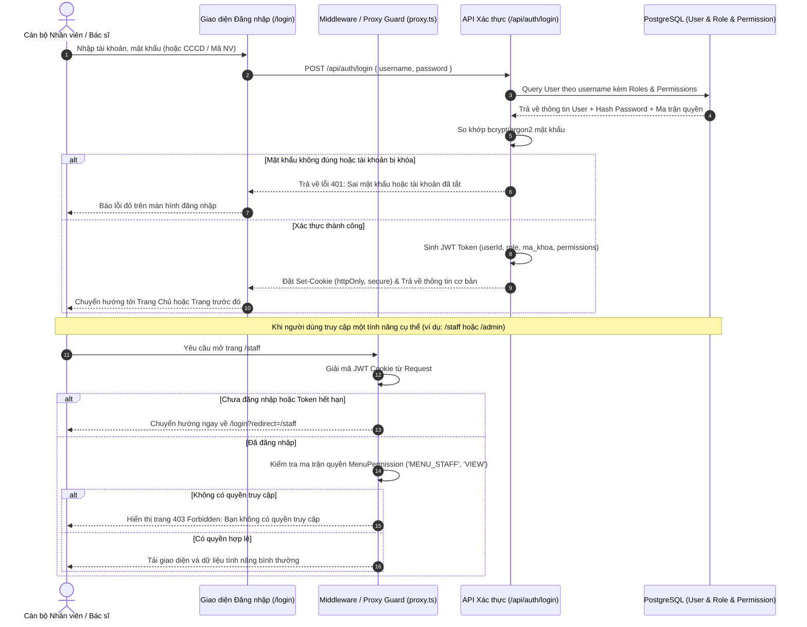
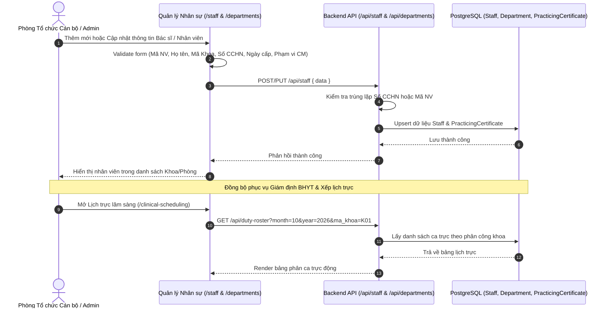
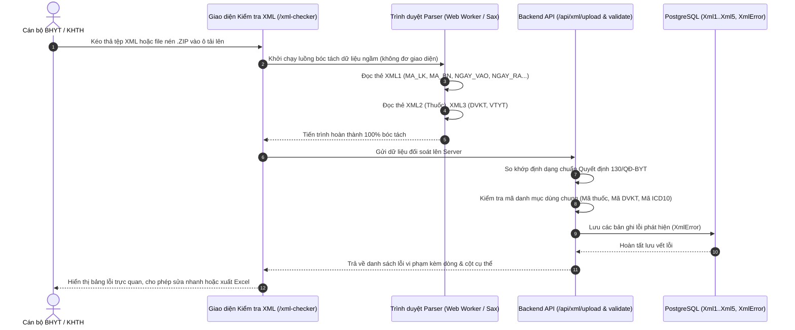
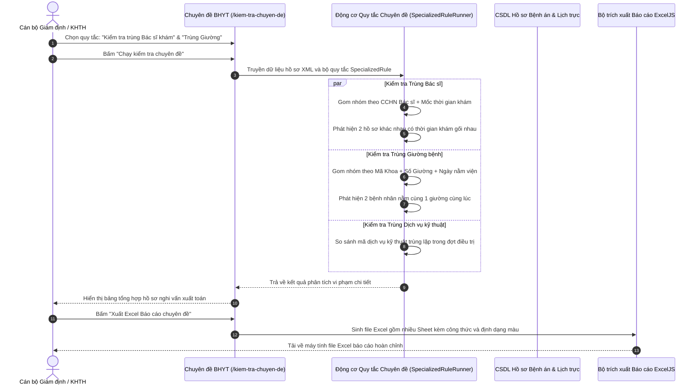
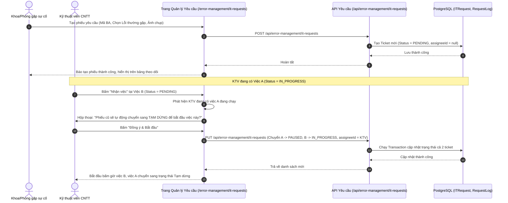
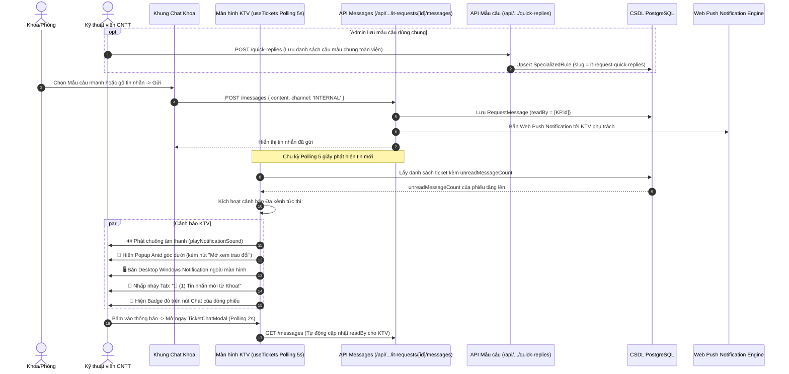
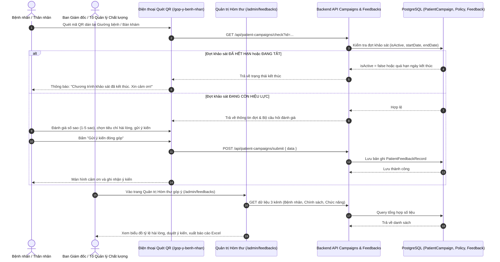
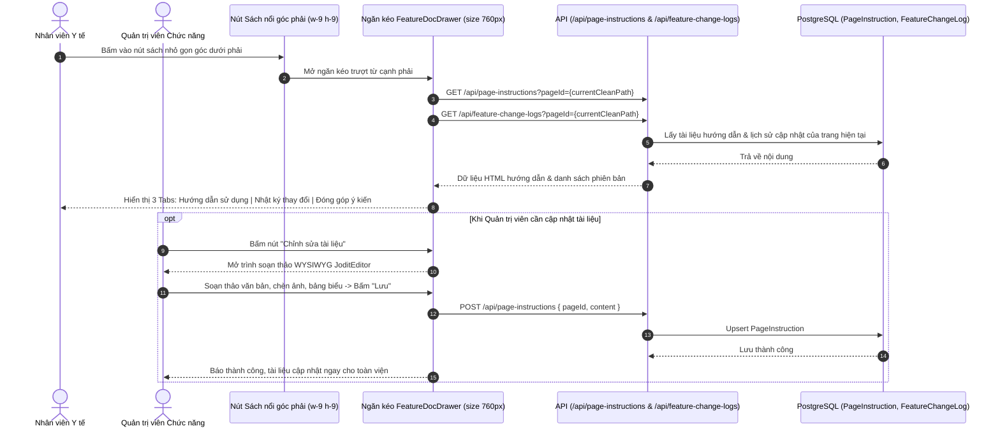

# 🏥 TOÀN BỘ KIẾN TRÚC & BIỂU ĐỒ TRÌNH TỰ (SEQUENCE DIAGRAMS)
### Hệ thống Quản trị & Quản lý Chất lượng Bệnh viện Đa khoa Lạng Sơn (HTQLBV)

---

## 📌 MỤC LỤC ĐIỀU HƯỚNG
- [1. SƠ ĐỒ TỔNG THỂ TOÀN HỆ THỐNG (MASTER SYSTEM ARCHITECTURE)](#1-sơ-đồ-tổng-thể-toàn-hệ-thống-master-system-architecture)
- [2. BIỂU ĐỒ TRÌNH TỰ CHI TIẾT TỪNG PHÂN HỆ](#2-biểu-đồ-trình-tự-chi-tiết-từng-phân-hệ)
  - [2.1. Xác thực Đăng nhập & Ma trận Phân quyền Đa cấp độ (Auth & RBAC)](#21-xác-thực-đăng-nhập--ma-trận-phân-quyền-đa-cấp-độ-auth--rbac)
  - [2.2. Quản lý Nhân sự, Khoa Phòng & Chứng chỉ Hành nghề (Staff & Department)](#22-quản-lý-nhân-sự-khoa-phòng--chứng-chỉ-hành-nghề-staff--department)
  - [2.3. Bóc tách & Kiểm tra Hồ sơ XML BHYT theo Quyết định 130/QĐ-BYT (Check XML)](#23-bóc-tách--kiểm-tra-hồ-sơ-xml-bhyt-theo-quyết-định-130qđ-byt-check-xml)
  - [2.4. Động cơ Kiểm tra Chuyên đề Trùng lặp BHYT (Specialized Rules Engine)](#24-động-cơ-kiểm-tra-chuyên-đề-trùng-lặp-bhyt-specialized-rules-engine)
  - [2.5. Quản lý Yêu cầu Kỹ thuật & Tiếp nhận 1 Việc Tập trung (IT Requests)](#25-quản-lý-yêu-cầu-kỹ-thuật--tiếp-nhận-1-việc-tập-trung-it-requests)
  - [2.6. Hệ thống Chat Đa kênh & Cảnh báo Thời gian thực (Real-time Notification)](#26-hệ-thống-chat-đa-kênh--cảnh-báo-thời-gian-thực-real-time-notification)
  - [2.7. Hòm thư Góp ý 3 Kênh & Khảo sát Người bệnh qua QR Mobile (Feedback)](#27-hòm-thư-góp-ý-3-kênh--khảo-sát-người-bệnh-qua-qr-mobile-feedback)
  - [2.8. Tủ sách Hướng dẫn Sử dụng & Quản lý Thay đổi (FeatureDocDrawer)](#28-tủ-sách-hướng-dẫn-sử-dụng--quản-lý-thay-đổi-featuredocdrawer)
- [3. TỔNG HỢP CÁC BẢNG CƠ SỞ DỮ LIỆU & ENDPOINTS CHÍNH](#3-tổng-hợp-các-bảng-cơ-sở-dữ-liệu--endpoints-chính)

---

## 1. SƠ ĐỒ TỔNG THỂ TOÀN HỆ THỐNG (MASTER SYSTEM ARCHITECTURE)

> **💡 HƯỚNG DẪN TƯƠNG TÁC:**
> Bấm (click) vào bất kỳ khối chức năng nào trong sơ đồ dưới đây để tự động nhảy đến **Sequence Diagram chi tiết** của chức năng đó!

```mermaid
flowchart TD
    classDef auth fill:#e0f2fe,stroke:#0284c7,stroke-width:2px;
    classDef staff fill:#fef3c7,stroke:#d97706,stroke-width:2px;
    classDef xml fill:#dcfce7,stroke:#16a34a,stroke-width:2px;
    classDef it fill:#f3e8ff,stroke:#9333ea,stroke-width:2px;
    classDef notif fill:#ffedd5,stroke:#ea580c,stroke-width:2px;
    classDef feedback fill:#ffe4e6,stroke:#e11d48,stroke-width:2px;
    classDef doc fill:#f1f5f9,stroke:#475569,stroke-width:2px;
    classDef core fill:#ffffff,stroke:#0f172a,stroke-width:3px;

    User["👥 NGƯỜI DÙNG BỆNH VIỆN<br/>(Bác sĩ, Điều dưỡng, CNTT, KHTH, Bệnh nhân, Giám đốc)"] --> Gateway["🔐 CỔNG ĐĂNG NHẬP & KIỂM SOÁT PHÂN QUYỀN"]:::core

    Gateway --> S1["1. Xác thực & Phân quyền RBAC"]:::auth
    Gateway --> S2["2. Quản lý Nhân sự & Khoa phòng"]:::staff
    Gateway --> S3["3. Bóc tách & Kiểm tra XML 1-5 (QĐ 130)"]:::xml
    Gateway --> S4["4. Kiểm tra Chuyên đề Trùng lặp BHYT"]:::xml
    Gateway --> S5["5. Yêu cầu Kỹ thuật & Tiếp nhận 1 việc"]:::it
    Gateway --> S6["6. Chat Đa kênh & Cảnh báo Tức thì"]:::notif
    Gateway --> S7["7. Hòm thư Góp ý 3 Kênh (QR Mobile)"]:::feedback
    Gateway --> S8["8. Tủ sách Hướng dẫn & Nhật ký Thay đổi"]:::doc

    S1 --> DB[("🗄️ CƠ SỞ DỮ LIỆU POSTGRESQL (PRISMA ORM)")]:::core
    S2 --> DB
    S3 --> DB
    S4 --> DB
    S5 --> DB
    S6 --> DB
    S7 --> DB
    S8 --> DB

    click S1 href "#21-xác-thực-đăng-nhập--ma-trận-phân-quyền-đa-cấp-độ-auth--rbac" "Xem chi tiết Sequence Xác thực & Phân quyền"
    click S2 href "#22-quản-lý-nhân-sự-khoa-phòng--chứng-chỉ-hành-nghề-staff--department" "Xem chi tiết Sequence Quản lý Nhân sự & Khoa phòng"
    click S3 href "#23-bóc-tách--kiểm-tra-hồ-sơ-xml-bhyt-theo-quyết-định-130qđ-byt-check-xml" "Xem chi tiết Sequence Bóc tách & Kiểm tra XML"
    click S4 href "#24-động-cơ-kiểm-tra-chuyên-đề-trùng-lặp-bhyt-specialized-rules-engine" "Xem chi tiết Sequence Kiểm tra Chuyên đề Trùng lặp"
    click S5 href "#25-quản-lý-yêu-cầu-kỹ-thuật--tiếp-nhận-1-việc-tập-trung-it-requests" "Xem chi tiết Sequence Tiếp nhận Yêu cầu 1 việc"
    click S6 href "#26-hệ-thống-chat-đa-kênh--cảnh-báo-thời-gian-thực-real-time-notification" "Xem chi tiết Sequence Chat & Cảnh báo Tức thì"
    click S7 href "#27-hòm-thư-góp-ý-3-kênh--khảo-sát-người-bệnh-qua-qr-mobile-feedback" "Xem chi tiết Sequence Hòm thư Góp ý & QR Bệnh nhân"
    click S8 href "#28-tủ-sách-hướng-dẫn-sử-dụng--quản-lý-thay-đổi-featuredocdrawer" "Xem chi tiết Sequence Tủ sách Hướng dẫn"
```

---

## 2. BIỂU ĐỒ TRÌNH TỰ CHI TIẾT TỪNG PHÂN HỆ

### 2.1. Xác thực Đăng nhập & Ma trận Phân quyền Đa cấp độ (Auth & RBAC)

> **Mô tả nghiệp vụ:** Người dùng đăng nhập bằng tên tài khoản/mã nhân viên/CCCD. Hệ thống kiểm tra mật khẩu đã hash, cấp phiên làm việc JWT Cookie, sau đó kiểm tra ma trận phân quyền từng tính năng (`VIEW`, `CREATE`, `UPDATE`, `DELETE`) thông qua Middleware / `proxy.ts`.

[⬆ Quay lại Sơ đồ Tổng thể](#1-sơ-đồ-tổng-thể-toàn-hệ-thống-master-system-architecture)

---

### 2.2. Quản lý Nhân sự, Khoa Phòng & Chứng chỉ Hành nghề (Staff & Department)

> **Mô tả nghiệp vụ:** Quản lý cơ cấu tổ chức bệnh viện, khoa/phòng, thông tin nhân viên y tế, số chứng chỉ hành nghề (CCHN), phạm vi chuyên môn kỹ thuật được phép thực hiện, và phân công lịch trực lâm sàng.

[⬆ Quay lại Sơ đồ Tổng thể](#1-sơ-đồ-tổng-thể-toàn-hệ-thống-master-system-architecture)

---

### 2.3. Bóc tách & Kiểm tra Hồ sơ XML BHYT theo Quyết định 130/QĐ-BYT (Check XML)

> **Mô tả nghiệp vụ:** Tiếp nhận gói hồ sơ XML (XML1: Tổng hợp; XML2: Thuốc; XML3: Dịch vụ kỹ thuật & Vật tư; XML4: Diễn biến bệnh; XML5: Khám bệnh). Phân tích cú pháp, kiểm tra lỗi kỹ thuật và đối chiếu cấu trúc chuẩn dữ liệu gửi cổng giám định BHYT.

[⬆ Quay lại Sơ đồ Tổng thể](#1-sơ-đồ-tổng-thể-toàn-hệ-thống-master-system-architecture)

---

### 2.4. Động cơ Kiểm tra Chuyên đề Trùng lặp BHYT (Specialized Rules Engine)

> **Mô tả nghiệp vụ:** Thuật toán phát hiện các vi phạm quy chế khám chữa bệnh dẫn đến nguy cơ xuất toán BHYT: 1 Bác sĩ khám tại 2 buồng trong cùng khung giờ; 1 Bệnh nhân nằm tại 2 giường khác nhau; trùng lặp dịch vụ kỹ thuật trong cùng ngày.

[⬆ Quay lại Sơ đồ Tổng thể](#1-sơ-đồ-tổng-thể-toàn-hệ-thống-master-system-architecture)

---

### 2.5. Quản lý Yêu cầu Kỹ thuật & Tiếp nhận 1 Việc Tập trung (IT Requests)

> **Mô tả nghiệp vụ:** Tiếp nhận và xử lý sự cố CNTT, VTYT, Hậu cần. Thực hiện nghiêm ngặt quy chế **"Mỗi kỹ thuật viên chỉ tập trung 1 việc tại một thời điểm"**: Khi nhận việc mới, phiếu đang làm cũ tự động chuyển sang trạng thái Tạm dừng.

[⬆ Quay lại Sơ đồ Tổng thể](#1-sơ-đồ-tổng-thể-toàn-hệ-thống-master-system-architecture)

---

### 2.6. Hệ thống Chat Đa kênh & Cảnh báo Thời gian thực (Real-time Notification)

> **Mô tả nghiệp vụ:** Trao đổi trực tiếp trên từng phiếu yêu cầu (Kênh nội bộ với Khoa và Kênh đối tác với hãng VNPT/Viettel/FPT). Khi Khoa phòng gửi tin nhắn, KTV phụ trách lập tức nhận chuông báo, popup góc màn hình, thông báo Desktop và nhấp nháy tab trình duyệt. Sử dụng mẫu câu trả lời nhanh dùng chung toàn viện kết hợp mẫu cá nhân.

[⬆ Quay lại Sơ đồ Tổng thể](#1-sơ-đồ-tổng-thể-toàn-hệ-thống-master-system-architecture)

---

### 2.7. Hòm thư Góp ý 3 Kênh & Khảo sát Người bệnh qua QR Mobile (Feedback)

> **Mô tả nghiệp vụ:** Hệ thống hòm thư góp ý 3 kênh: (1) Bệnh nhân quét mã QR tại buồng bệnh/bàn khám trên điện thoại (tự động kiểm tra hạn và trạng thái hiệu lực); (2) Khoa/Phòng góp ý dự thảo văn bản chính sách; (3) Cán bộ nhân viên góp ý chức năng phần mềm kèm file đính kèm.

[⬆ Quay lại Sơ đồ Tổng thể](#1-sơ-đồ-tổng-thể-toàn-hệ-thống-master-system-architecture)

---

### 2.8. Tủ sách Hướng dẫn Sử dụng & Quản lý Thay đổi (FeatureDocDrawer)

> **Mô tả nghiệp vụ:** Tủ sách hướng dẫn tích hợp tại mọi màn hình chức năng thông qua nút nổi nhỏ gọn ở góc dưới bên phải màn hình. Người dùng xem tài liệu chuẩn hóa và lịch sử cập nhật phiên bản. Quản trị viên có thể soạn thảo trực tiếp bằng JoditEditor.

[⬆ Quay lại Sơ đồ Tổng thể](#1-sơ-đồ-tổng-thể-toàn-hệ-thống-master-system-architecture)

---

## 3. TỔNG HỢP CÁC BẢNG CƠ SỞ DỮ LIỆU & ENDPOINTS CHÍNH

| Phân hệ | Các Bảng CSDL (Prisma Models) | Endpoints API chính | Màn hình giao diện |
| :--- | :--- | :--- | :--- |
| **1. Xác thực & Phân quyền** | `User`, `Role`, `UserRole`, `MenuPermission` | `/api/auth/login`, `/api/auth/me`, `/api/users`, `/api/roles` | `/login`, `/users`, `/roles` |
| **2. Quản lý Nhân sự & Tổ chức** | `Staff`, `Department`, `PracticingCertificate`, `Specialty` | `/api/staff`, `/api/departments`, `/api/duty-roster` | `/staff`, `/departments`, `/clinical-scheduling` |
| **3. Giám định Hồ sơ XML BHYT** | `Xml1`, `Xml2`, `Xml3`, `Xml4`, `Xml5`, `XmlError` | `/api/xml/upload`, `/api/xml/validate`, `/api/xml/errors` | `/xml-checker`, `/xml-sua-ba`, `/xml3` |
| **4. Kiểm tra Chuyên đề Trùng lặp** | `SpecializedRule`, `SpecializedResult` | `/api/specialized-rules`, `/api/specialized-export` | `/kiem-tra-chuyen-de`, `/chuyen-de` |
| **5. Yêu cầu Kỹ thuật & Sự cố** | `ITRequest`, `RequestLog` | `/api/error-management/it-requests`, `/api/error-management/it-request-config` | `/error-management/it-requests` |
| **6. Chat Đa kênh & Cảnh báo** | `RequestMessage`, `NotificationSetting` | `/api/error-management/it-requests/[id]/messages`, `/api/error-management/quick-replies` | `TicketChatModal`, `useTickets` |
| **7. Hòm thư Góp ý 3 Kênh** | `PatientFeedbackCampaign`, `PatientFeedbackRecord`, `HospitalPolicy`, `FeatureFeedback` | `/api/patient-campaigns`, `/api/hospital-policies`, `/api/feature-feedback` | `/gop-y-benh-nhan`, `/gop-y-chinh-sach`, `/admin/feedbacks` |
| **8. Tủ sách & Nhật ký Thay đổi** | `PageInstruction`, `FeatureChangeLog` | `/api/page-instructions`, `/api/feature-change-logs` | `FeatureDocDrawer`, `/huong-dan` |
